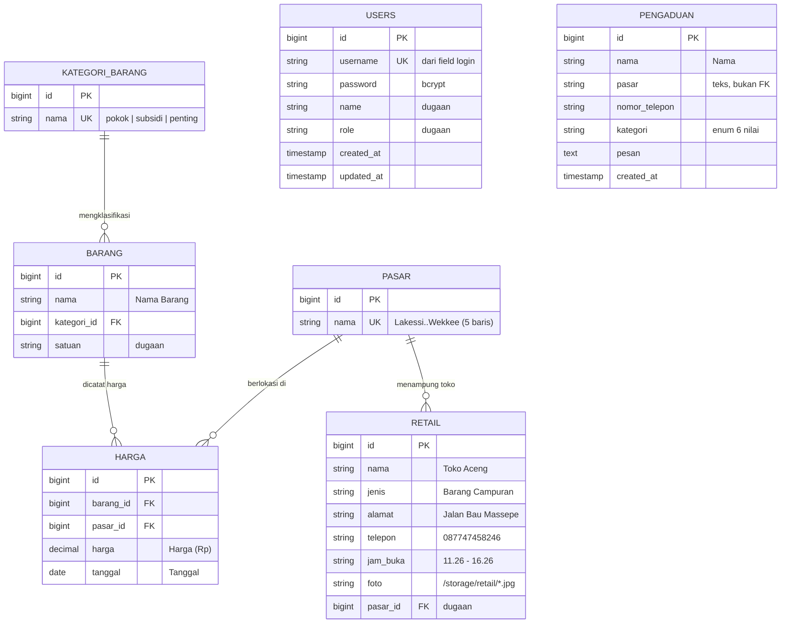

# ERD — SIPHP Kota Parepare

**Target:** https://www.siphp-parepare.com/
**Metode:** Observasi pasif artefak publik (HTML, JS, form, header HTTP, route)
**Tanggal analisis:** 2026-10-15

---

## ⚠️ DISCLAIMER — BACA DULU

ERD ini **hasil inferensi** dari bukti publik, **bukan** hasil dumping/verifikasi
langsung ke database produksi. Tidak ada SQL injection, probing endpoint internal,
atau akses terautentikasi yang dilakukan.

**Konsekuensi:** nama tabel & kolom di bawah adalah **rekonstruksi terbaik** dari
bukti yang tersedia. Nama tabel `barang`, `harga`, `pasar` adalah **usulan penamaan**;
nama asli di database bisa berbeda (mis. `barangs`, `data_harga`, `tb_pasar`).

Verifikasi definitif hanya bisa lewat akses resmi (migrasi Laravel / `SHOW TABLES`)
dengan izin pemilik sistem.

---

## Legenda Keyakinan

| Simbol | Arti | Dasar |
|--------|------|-------|
| 🔵 **Kuat** | Nama field/kolom terlihat langsung | Terbaca dari `name=` form, header tabel, atau data publik |
| 🟡 **Sedang** | Struktur jelas, nama kolom menebak | Pola relasi/UI yang konsisten |
| 🔴 **Lemah** | Eksistensi entitas belum pasti | Hanya indikasi tidak langsung |

---

## 1. Fakta Teramati (Observed)

```
Framework : Laravel + Vite
Set-Cookie: XSRF-TOKEN=...; siphp-session=...   (khas Laravel)
Server    : LiteSpeed
Build     : /build/assets/app-C7CerPpK.css       (output Vite)
```

**Form Login** (`/login`, POST):
`_token` (CSRF) · `username` · `password`
→ field `username`, **bukan** `email` (beda dari default Laravel)

**Form Pengaduan** (`/pengaduan`, POST):
`_token` · `nama` · `pasar` (select) · `nomor_telepon` · `kategori` (select) · `pesan`

**Dropdown Pasar** (5): Lakessi, Senggol, Labukkang, Sumpang Minangae, Wekke'e
**Dropdown Kategori Pengaduan** (6): pasar, kebersihan, los kosong, harga, sistem, lainnya

**Tabel Harga** (`/info-harga/{kategori}/{pasarId}`), kolom:
`No` · `Nama Barang` · `Tanggal` · `Harga (Rp)`
Baris: `class="harga-row"` + atribut `data-nama` (search client-side)

**Kartu Retail** (`/`): Toko Aceng · Barang Campuran · Jalan Bau Massepe ·
087747458246 · 11.26-16.26 · foto `/storage/retail/<hash>.jpg`

**Route publik:**

| Route | Fungsi |
|-------|--------|
| `/` | Beranda + direktori ritel |
| `/pengaduan` | Form pengaduan warga |
| `/login` | Login (username/password) |
| `/info-harga/{kategori}/{pasarId}` | Harga per pasar (kategori: `barang-pokok`/`barang-subsidi`/`barang-penting`; pasarId: 1–5) |

> Catatan: seluruh 15 halaman harga (5 pasar × 3 kategori) **KOSONG** saat analisis
> (0 baris). Modul harga belum terisi data produksi.

---

## 2. ERD (Mermaid)



---

## 3. Diagram Versi ASCII (untuk dibaca cepat)

```
                 ┌──────────────────┐
                 │ KATEGORI_BARANG  │
                 │------------------│
                 │ id (PK)          │
                 │ nama             │  pokok / subsidi / penting
                 └────────┬─────────┘
                          │ 1
                          │
                          │ N
                 ┌────────┴─────────┐
                 │     BARANG       │
                 │------------------│
                 │ id (PK)          │
                 │ nama             │
                 │ kategori_id (FK) │
                 │ satuan           │
                 └────────┬─────────┘
                          │ 1
                          │
                          │ N
   ┌──────────────┐   ┌───┴──────────────┐
   │    PASAR     │   │      HARGA       │
   │--------------│   │------------------│
   │ id (PK)      │1  │ id (PK)          │
   │ nama         ├───┤ pasar_id (FK)    │
   └──────┬───────┘ N │ barang_id (FK)   │
          │           │ harga            │
          │ 1         │ tanggal          │
          │           └──────────────────┘
          │ N
   ┌──────┴───────┐        ┌──────────────────┐
   │    RETAIL    │        │    PENGADUAN     │
   │--------------│        │------------------│
   │ id (PK)      │        │ id (PK)          │
   │ nama         │        │ nama             │
   │ jenis        │        │ pasar  (TEXT)    │  ← bukan FK
   │ alamat       │        │ nomor_telepon    │
   │ telepon      │        │ kategori (enum)  │
   │ jam_buka     │        │ pesan            │
   │ foto         │        │ created_at       │
   │ pasar_id (FK)│        └──────────────────┘
   └──────────────┘

   ┌────────────────────────────────────────────┐
   │  TABEL FRAMEWORK LARAVEL (hampir pasti ada) │
   │  migrations · sessions · cache · cache_locks│
   │  jobs · job_batches · failed_jobs           │
   └────────────────────────────────────────────┘
```

---

## 4. Detail Entitas

### 🔵 `users` — Kuat
| Kolom | Tipe | Bukti |
|-------|------|-------|
| `id` | bigint PK | konvensi Laravel |
| `username` | string UK | **field login bernama `username`** |
| `password` | string | field login |
| `name` | string? | dugaan (tak terbukti) |
| `role` | string? | dugaan (ada area admin) |
| `created_at`/`updated_at` | timestamp | konvensi |

### 🔵 `pasar` — Kuat
`id` (PK) · `nama` — **5 baris** (Lakessi, Senggol, Labukkang, Sumpang Minangae, Wekke'e)

### 🟡 `kategori_barang` — Sedang
`id` (PK) · `nama` — nilai: `pokok`, `subsidi`, `penting`
Bisa jadi **enum hardcoded**, bukan tabel. Route `/info-harga/barang-pokok/...` membuktikan
ketiga kategori ini dipisah secara logis.

### 🟡 `barang` — Sedang
`id` (PK) · `nama` · `kategori_id` (FK) · `satuan`?
Dasar: kolom "Nama Barang" + kategori memisahkan daftar.

### 🔵 `harga` — Kuat
`id` · `barang_id` (FK) · `pasar_id` (FK) · `harga` (decimal) · `tanggal` (date)
Dasar: tabel publik menampilkan Nama Barang + Tanggal + Harga, difilter per pasar & kategori.

### 🔵 `pengaduan` — Kuat
`id` · `nama` · `pasar` · `nomor_telepon` · `kategori` · `pesan` · `created_at`
Kolom = nama field form **persis**. Nilai `pasar` & `kategori` dikirim sebagai **string**,
jadi kemungkinan **disimpan sebagai teks (denormalisasi), bukan foreign key**.

### 🟡 `retail` (toko) — Sedang
`id` · `nama` · `jenis` · `alamat` · `telepon` · `jam_buka` · `foto` · `pasar_id`?
Dasar: kartu toko di beranda + foto di `/storage/retail/`.
⚠️ Link "Kunjungi" mengarah ke `https://googlemap` (placeholder) → **tidak ada
kolom koordinat lat/long** yang dipakai (atau belum diimplementasikan).

---

## 5. DDL Inferensi (SQL — usulan, bukan hasil dump)

```sql
-- ===== Laravel framework =====
CREATE TABLE migrations        (id INT AUTO_INCREMENT PK, migration VARCHAR, batch INT);
CREATE TABLE sessions          (id VARCHAR PK, user_id BIGINT NULL, ip_address VARCHAR,
                                user_agent TEXT, payload LONGTEXT, last_activity INT);
CREATE TABLE cache             (key VARCHAR PK, value MEDIUMTEXT, expiration INT);
CREATE TABLE cache_locks       (key VARCHAR PK, owner VARCHAR, expiration INT);
CREATE TABLE jobs              (id BIGINT PK, queue VARCHAR, payload LONGTEXT,
                                attempts TINYINT, reserved_at INT, available_at INT, created_at INT);
CREATE TABLE job_batches       (id VARCHAR PK, name VARCHAR, total_jobs INT, pending_jobs INT,
                                failed_jobs INT, failed_job_ids LONGTEXT,
                                options MEDIUMTEXT, cancelled_at INT, created_at INT, finished_at INT);
CREATE TABLE failed_jobs       (id BIGINT PK, uuid VARCHAR UNIQUE, connection TEXT,
                                queue TEXT, payload LONGTEXT, exception LONGTEXT, failed_at TIMESTAMP);

-- ===== Domain =====
CREATE TABLE users (
    id         BIGINT AUTO_INCREMENT PRIMARY KEY,
    username   VARCHAR(255) UNIQUE NOT NULL,   -- 🔵 field login
    password   VARCHAR(255) NOT NULL,
    name       VARCHAR(255) NULL,              -- 🟡 dugaan
    role       VARCHAR(50)  NULL,              -- 🟡 dugaan
    created_at TIMESTAMP NULL,
    updated_at TIMESTAMP NULL
);

CREATE TABLE pasar (                           -- 🔵 5 baris
    id   BIGINT AUTO_INCREMENT PRIMARY KEY,
    nama VARCHAR(255) UNIQUE NOT NULL
);

CREATE TABLE kategori_barang (                 -- 🟡 bisa enum, bukan tabel
    id   BIGINT AUTO_INCREMENT PRIMARY KEY,
    nama VARCHAR(50) NOT NULL                  -- pokok | subsidi | penting
);

CREATE TABLE barang (
    id          BIGINT AUTO_INCREMENT PRIMARY KEY,
    nama        VARCHAR(255) NOT NULL,
    kategori_id BIGINT NULL,
    satuan      VARCHAR(50) NULL,              -- 🟡 dugaan
    CONSTRAINT fk_barang_kategori FOREIGN KEY (kategori_id)
        REFERENCES kategori_barang(id)
);

CREATE TABLE harga (                           -- 🔵
    id        BIGINT AUTO_INCREMENT PRIMARY KEY,
    barang_id BIGINT  NOT NULL,
    pasar_id  BIGINT  NOT NULL,
    harga     DECIMAL(14,2) NOT NULL,
    tanggal   DATE NOT NULL,
    CONSTRAINT fk_harga_barang FOREIGN KEY (barang_id) REFERENCES barang(id),
    CONSTRAINT fk_harga_pasar  FOREIGN KEY (pasar_id)  REFERENCES pasar(id)
);

CREATE TABLE pengaduan (                       -- 🔵
    id            BIGINT AUTO_INCREMENT PRIMARY KEY,
    nama          VARCHAR(255) NOT NULL,
    pasar         VARCHAR(255) NOT NULL,       -- teks, BUKAN FK
    nomor_telepon VARCHAR(30)  NULL,
    kategori      VARCHAR(50)  NOT NULL,       -- pasar|kebersihan|los kosong|harga|sistem|lainnya
    pesan         TEXT         NOT NULL,
    created_at    TIMESTAMP NULL,
    updated_at    TIMESTAMP NULL
);

CREATE TABLE retail (                          -- 🟡
    id       BIGINT AUTO_INCREMENT PRIMARY KEY,
    nama     VARCHAR(255) NOT NULL,
    jenis    VARCHAR(100) NULL,
    alamat   VARCHAR(255) NULL,
    telepon  VARCHAR(30)  NULL,
    jam_buka VARCHAR(50)  NULL,                -- format "11.26 - 16.26"
    foto     VARCHAR(255) NULL,                -- /storage/retail/<hash>.jpg
    pasar_id BIGINT NULL,
    CONSTRAINT fk_retail_pasar FOREIGN KEY (pasar_id) REFERENCES pasar(id)
);
```

---

## 6. Yang BELUM Terverifikasi (jangan dianggap final)

1. Nama tabel asli — `barang`/`harga`/`pasar` bisa `barangs`/`tb_harga`/`tb_pasar`.
2. Apakah `kategori_barang` benar tabel atau enum.
3. Apakah `harga` menyimpan riwayat (multi-baris per barang) atau 1 baris terbaru.
4. Kolom `users` selain `username`/`password` — belum terbukti.
5. Relasi `pengaduan.pasar` — teks vs FK.
6. Apakah `retail` punya `pasar_id` atau berdiri sendiri.
7. Kolom `created_at`/`updated_at` di `pasar`, `kategori_barang`, `barang`.

## 7. Cara Verifikasi Definitif (butuh izin resmi)

- Jalankan `php artisan migrate:status` atau lihat folder `database/migrations/`
- `SHOW CREATE TABLE` / `SHOW TABLES` via akses DB
- Buka model Eloquent (`app/Models/*.php`) — relasi `hasMany`/`belongsTo`

---

*Dokumen ini untuk keperluan edukasi & dokumentasi. Struktur database sistem
pemerintah adalah data internal — verifikasi hanya dengan izin pengelola SIPHP.*
