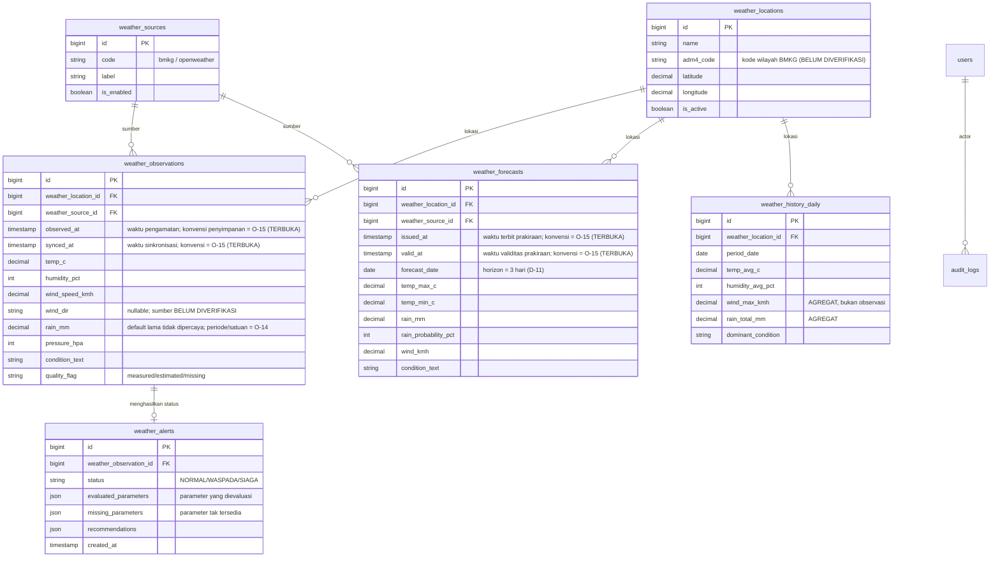
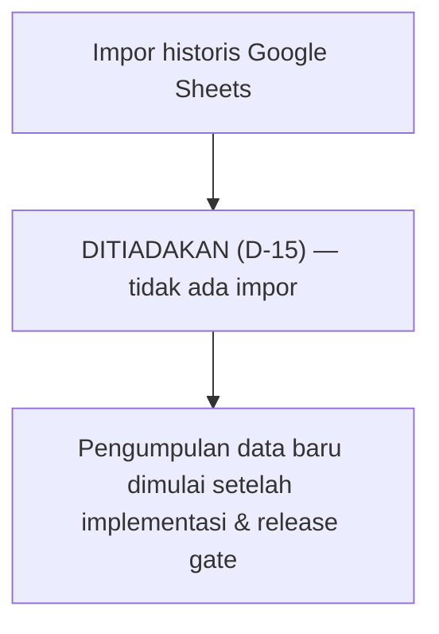

# WINDY DATA MAPPING
## Rancangan Model Data MySQL & Pemetaan Data Lama

- **Proyek:** SuperBie — Lapor Pak Wali (`D:\Kuliah\Semester 7\Magang\superbie`)
- **Dokumen pendamping:** `WINDY_MIGRATION_PLAN.md`, `WINDY_TARGET_ARCHITECTURE.md`, `WINDY_ACCESS_MATRIX.md`, `WINDY_ACCEPTANCE_CRITERIA.md`
- **Sumber analisis:** `WINDY_MIGRATION_AUDIT.md` (Audit), khususnya §7
- **Sifat:** **DESAIN KONSEPTUAL — TIDAK ADA IMPLEMENTASI, TIDAK ADA AKSES DATABASE/SHEETS**
- **Status:** `DRAFT REVISI 3 (PHASE 4E) — KEPUTUSAN PEMILIK D-11…D-17 DICATAT; SEMUA TABEL [USULAN]`
- **Tanggal revisi:** **2026-10-12** (revisi Phase 1) · **2026-10-13** (penyelarasan Phase 3) · **2026-10-14** (pembaruan dokumentasi Phase 4E)

> **Peringatan penandaan.**
> - **Struktur, jumlah baris, isi, dan kualitas Google Sheets sebenarnya BELUM DIPERIKSA** (Audit U-1) — namun **D-15: tidak ada impor historis Google Sheets**, sehingga pemetaan §4 sheet lama **tidak lagi menjadi jalur impor** dan hanya dipertahankan sebagai **referensi historis**.
> - Semua nama tabel/kolom MySQL adalah **[USULAN]** dan belum final; semua constraint adalah **[USULAN]** yang **harus divalidasi** terhadap bentuk payload dan kebutuhan data aktual.
> - **Tidak ada** akses Google Sheets, impor, atau perubahan database yang dilakukan pada tahap ini.
> - **Phase 3:** model data ini **belum** masuk `schema.md` dan **bukan** bagian migration saat ini; harus divalidasi pada gerbang F3 dan ditulis ke `schema.md` **lebih dulu** sebelum migration apa pun.
> - **Phase 4E:** horizon prakiraan = **3 hari** (D-11); **tampilan WITA** (D-12); **ambang lama = nilai awal** (D-13); **tanpa impor historis** (D-15).

---

## 0. Legenda Status

| Label | Arti |
|---|---|
| **FINAL** | Keputusan pengguna mengikat (**D-1…D-10** di `WINDY_MIGRATION_PLAN.md` §1.2 dan **D-11…D-17** di §1.2.1). |
| **[USULAN]** | Usulan teknis; belum disetujui; belum divalidasi. |
| **BELUM DIVERIFIKASI** | Belum diperiksa terhadap repository/API/Sheets. |
| **TERBUKA (O-n)** | Pertanyaan menunggu keputusan pemilik. |

---

## 1. Prinsip Model Data

1. **MySQL sebagai penyimpanan utama** (FINAL, D-4).
2. **Normalisasi & konsistensi:** tabel `snake_case` plural (konvensi SuperBie — Audit §5.9); **jangan** memakai nama sheet lama (`Weather_Current`).
3. **Integritas:** PK `BIGINT UNSIGNED AUTO_INCREMENT`, FK eksplisit, index pada jalur query nyata, `timestamps()`, enum/string untuk status terkontrol, **unique constraint** untuk mencegah duplikasi (menggantikan ketiadaan `LockService` lama — Audit S-7).
4. **Pemisahan konsep data yang tegas** (§2): observasi ≠ agregat historis ≠ prakiraan ≠ peringatan ≠ metadata sumber. **Tidak ada** konsep "metadata batch impor" karena **tidak ada impor historis (D-15)**.
5. **Tidak menyalin cacat lama:** nilai hardcode (`wave_meter`, `clouds_pct`, `visibility_km`), nilai default (`rain` 5.0), dan header tidak konsisten (Audit §3.11) **tidak** direplikasi.
6. **Tidak ada entitas GIS/batas wilayah** (FINAL, D-9).

---

## 2. Pemisahan Konsep Data (WAJIB)

> Kesalahan utama desain sebelumnya: mencampur konsep-konsep berikut. Revisi ini memisahkannya secara eksplisit.

| Konsep | Definisi | Entitas target [USULAN] |
|---|---|---|
| **Observasi cuaca** | Nilai terukur pada **satu titik waktu** dari satu sumber | `weather_observations` |
| **Agregat historis** | Ringkasan (rata-rata/maksimum/total) atas **rentang waktu** | `weather_history_daily` (atau agregat terpisah) [USULAN] |
| **Prakiraan** | Nilai yang **diprediksi** untuk waktu mendatang | `weather_forecasts` [USULAN] |
| **Status / peringatan** | Hasil evaluasi risiko + alasan + rekomendasi | `weather_alerts` [USULAN] |
| **Metadata sumber & kualitas** | Identitas sumber, waktu terbit, penanda kualitas | `weather_sources` + kolom kualitas di entitas terkait |

> **Catatan Phase 4E:** konsep **"metadata batch impor"** **tidak berlaku** karena **tidak ada impor historis (D-15)**; tabel `weather_import_batches` **tidak diperlukan**.

### 2.1 Aturan semantik penting
- **`Wind_Max` (agregat) TIDAK sama dengan `wind_speed_kmh` (observasi sesaat).** Nilai maksimum atas rentang waktu **tidak boleh** dipetakan langsung ke kolom observasi sesaat. Agregat harus masuk ke entitas agregat dengan nama/semantik yang benar (mis. `wind_max_kmh` pada entitas agregat), **bukan** ditumpuk ke `weather_observations.wind_speed_kmh`.
- **`Temp_Avg`, `Humidity_Avg`, `Rain_Total`, `Dominant_Condition`** juga merupakan **agregat**, bukan observasi. Jangan mencampurnya dengan observasi sesaat.
- **Nilai default lama** (mis. `rain` 5.0 dari `WeatherAPI.js:49`) **bukan pengukuran aktual** sampai sumber & semantiknya dibuktikan → **BELUM DIVERIFIKASI** (lihat §5).

---

## 3. Diagram Relasi (Mermaid — [USULAN])

> Semua entitas di atas **[USULAN]**. Relasi & kolom final menunggu F3. **Constraint bersifat usulan** dan harus divalidasi (§6). **Tidak ada** entitas `weather_import_batches` (D-15: tanpa impor historis).

---

## 4. Pemetaan Data Lama → Model Target

> Sumber pemetaan: **header yang terlihat pada kode** (Audit §7.1), **bukan** data nyata. **Catatan Phase 4E:** karena **tidak ada impor historis (D-15)**, pemetaan di §4.1–§4.3 sheet lama **hanya referensi historis** dan **bukan** jalur impor.

### 4.1 Sheet lama `Weather_Current` → `weather_observations` [USULAN]

| Kolom sheet (kode) | Bukti | Kolom target [USULAN] | Catatan |
|---|---|---|---|
| Timestamp (WITA) | `Database.js:36` | `observed_at` | Konversi ke waktu; **tampilan WITA (D-12)**; penyimpanan = O-15 |
| Temperature (°C) | `Database.js:36` | `temp_c` | Observasi |
| Humidity (%) | `Database.js:36` | `humidity_pct` | Observasi |
| Wind (km/h) | `Database.js:36` | `wind_speed_kmh` | Observasi sesaat |
| (tidak ada di sheet) | Audit §3.11 #2 | `wind_dir` | **Tidak pernah dihasilkan** aggregator lama → `NULL`/BELUM DIVERIFIKASI |
| Rain (mm) | `Database.js:36` | `rain_mm` | **Nilai default lama (5.0) bukan pengukuran** → tandai kualitas; **periode/satuan = O-14 (D-13)** |
| Pressure (hPa) | `Database.js:36` | `pressure_hpa` | Observasi |
| Condition | `Database.js:36` | `condition_text` | Sumber BMKG |
| — | Audit §3.11 #3 | `clouds_pct` | Lama **hardcode 50** → **jangan** disalin; sumber nyata BELUM DIVERIFIKASI |
| — | Audit §3.11 #3 | `visibility_km` | Lama **hardcode "10.0"** → **jangan** disalin; sumber nyata BELUM DIVERIFIKASI |
| — | Audit §3.11 #3 | `wave_meter` | Lama **hardcode** → **jangan** disalin; sumber nyata BELUM DIVERIFIKASI |
| — | — | `quality_flag` | [USULAN] menandai `measured`/`estimated`/`missing` |
| — | — | `synced_at` | [USULAN] waktu sistem mengambil data |

### 4.2 Sheet lama `Weather_History` → `weather_history_daily` (**AGREGAT**, bukan observasi)

> ⚠️ **Koreksi penting:** kolom sheet ini adalah **agregat**, **bukan** observasi sesaat. Pemetaan sebelumnya (`Wind_Max` → `wind_speed_kmh`) **salah** dan diperbaiki di sini.

| Kolom sheet (kode) | Bukti | Kolom target [USULAN] | Semantik |
|---|---|---|---|
| Date | `Database.js:42` | `period_date` | Tanggal periode agregat |
| Time | `Trigger.js:37` | (metadata periode) | Jam pencatatan; BELUM DIVERIFIKASI |
| Temp_Avg | `Database.js:42` | `temp_avg_c` | **Rata-rata** (agregat) |
| Humidity_Avg | `Database.js:42` | `humidity_avg_pct` | **Rata-rata** (agregat) |
| Wind_Max | `Database.js:42` | `wind_max_kmh` | **Maksimum** (agregat) — **bukan** observasi sesaat |
| Rain_Total | `Database.js:42` | `rain_total_mm` | **Total** (agregat) |
| Dominant_Condition | `Database.js:42` | `dominant_condition` | **Kondisi dominan** (agregat) |

> ⚠️ **Header `Weather_History` tidak konsisten** antara `initializeSheets` dan `appendHourlyToHistory` (Audit §3.11 #4). Struktur sebenarnya **BELUM DIVERIFIKASI** (DV-4).

### 4.3 Sheet lama `Weather_Alert` → `weather_alerts` [USULAN]

| Kolom sheet (kode) | Bukti | Kolom target [USULAN] | Catatan |
|---|---|---|---|
| Timestamp | `Database.js:48` | FK observasi / `created_at` | — |
| Status | `Database.js:48` | `status` | `WASPADA`/`SIAGA` (NORMAL tidak ditulis) |
| Trigger_Parameters | `Database.js:48` | `evaluated_parameters` (JSON) | Lama: `reasons.join(" \| ")` |
| Government_Recommendations | `Database.js:48` | `recommendations` (JSON) | Lama: `recommendations.join(" \| ")` |

### 4.4 Payload runtime lama → model internal

Payload lama (Audit §7.1): `{timestamp, location, current, risk, forecast_7d, hourly_forecast, is_cached}`

- `current` → `weather_observations`.
- `risk` → `weather_alerts` (+ status).
- `forecast_7d` → **JANGAN** dari generator sintetis lama; diisi dari **API BMKG gratis** (D-5, D-11) → `weather_forecasts`, dengan **horizon 3 hari** (bukan 7).
- `hourly_forecast` → **BELUM DIVERIFIKASI** apakah disimpan (DV-8).

---

## 5. Nilai Default & Hardcode Lama (JANGAN dipercaya sebagai pengukuran)

> Semua item berikut **tidak layak dianggap pengukuran aktual** sampai sumber & semantiknya dibuktikan.

| Nilai lama | Lokasi kode | Masalah | Perlakuan [USULAN] |
|---|---|---|---|
| `rain_mm` default `5.0` | **`WeatherAPI.js:49`** (`rain_mm: owm ? (owm.current.rain_3h_mm \|\| 0) : 5.0`) — *dipakai saat OWM absen* | Nilai default, **bukan** curah hujan terukur | Tandai `quality_flag = missing/estimated`; **jangan** dipakai untuk ambang SIAGA/WASPADA tanpa bukti |
| `wave_meter` (konstan) | `WeatherAPI.js:52` | Hardcode, tidak dari API | Tidak ditampilkan sebagai aktual; sumber nyata BELUM DIVERIFIKASI |
| `clouds_pct: 50` | `Database.js:101-103` | Hardcode | Tidak ditampilkan sebagai aktual |
| `visibility_km: "10.0"` | `Database.js:101-103` | Hardcode | Tidak ditampilkan sebagai aktual |
| `wave_meter: 1.0` | `Database.js:101-103` | Hardcode | Tidak ditampilkan sebagai aktual |

---

## 6. Unique Constraint & Strategi Idempotensi ([USULAN] — wajib divalidasi)

> Semua constraint adalah **[USULAN]**; validitas bergantung pada bentuk payload & kebutuhan data aktual (belum diverifikasi).

| Entitas | Usulan unique constraint | Tujuan | Risiko bila salah |
|---|---|---|---|
| `weather_observations` | (`weather_location_id`, `weather_source_id`, `observed_at`) | Cegah duplikat observasi | Sumber berbeda pada waktu sama boleh ada → **jangan** paksa unik lintas sumber |
| `weather_forecasts` | (`weather_location_id`, `weather_source_id`, `issued_at`, `valid_at`) | Cegah duplikat prakiraan | Sumber dapat menerbitkan revisi prakiraan → mungkin perlu versi/`issued_at` berbeda |
| `weather_history_daily` | (`weather_location_id`, `period_date`) | Cegah duplikat agregat harian | Bila sumber berbeda → mungkin perlu `weather_source_id` |
| `weather_alerts` | (`weather_observation_id`, `status`) | Cegah alert ganda per observasi | Bila satu observasi menghasilkan beberapa alert berversi → perlu penyesuaian |

> **Catatan Phase 4E:** tabel `weather_import_batches` **tidak diperlukan** karena **tidak ada impor historis (D-15)**.

- **Idempotensi (bukan impor):** unique constraint mencegah duplikasi baris **hasil sinkronisasi** (bukan impor Sheets).
- **Semua constraint harus diuji terhadap data nyata** sebelum finalisasi (F3).

---

## 7. Alur Impor Google Sheets — ⛔ **DITIADAKAN (D-15)**

> **Keputusan pemilik (FINAL, D-15):** **tidak ada impor historis Google Sheets.** **Jangan** membaca/menyalin/mengimpor/mengubah/menghapus data Google Sheets. Pengumpulan data baru **baru dimulai setelah implementasi & persetujuan release gate**. Karena itu, **seluruh alur impor di bawah tidak berlaku** dan **tidak boleh dijalankan**. Tidak ada dry-run, tidak ada penulisan DB dari Sheets.

### 7.1 Detail langkah (TIDAK BERLAKU)

| Langkah | Isi | Gerbang |
|---|---|---|
| 1–10 | ~~Inventarisasi → validasi → pemetaan → aturan kualitas → dry-run → laporan → persetujuan → impor idempoten → rekonsiliasi → pemulihan~~ | ⛔ **DITIADAKAN (D-15)** |

### 7.2 Strategi Transaksi & Batas Batch — **TIDAK BERLAKU (D-15)**

### 7.3 Metadata Batch Impor — **TIDAK BERLAKU (D-15)**

### 7.4 Aturan deduplikasi & konflik — **TIDAK BERLAKU (D-15)**

> **Catatan:** skema `weather_import_batches` dan kolom `import_batch_id` **tidak diperlukan** karena tidak ada impor. Jangan merancangnya.

---

## 8. Strategi Validasi Data

| Aspek | Aturan [USULAN] |
|---|---|
| **Tipe & rentang** | Suhu/angin/hujan/tekanan: numerik; kelembapan 0–100%; koordinat dalam batas; timestamp valid |
| **Timestamp** | Wajib valid; **tampilan = WITA (FINAL, D-12)**; **konvensi penyimpanan = O-15 (keputusan teknis perlu klarifikasi)**; timestamp invalid → **ditolak**. **Phase 2:** spesifikasi mengusulkan UTC, pola proyek existing menyimpan waktu lokal (`Asia/Makassar`) — divergensi **tidak** diselesaikan diam-diam; jangan mencampur zona waktu. |
| **Satuan** | °C, km/jam, mm, hPa — **dikonfirmasi** terhadap sumber; normalisasi bila berbeda (BELUM DIVERIFIKASI). **Hujan: periode/satuan wajib diperjelas (D-13)** — jangan bandingkan mm/3 jam dengan mm/hari. |
| **Nilai kosong** | Field wajib kosong → **ditolak**; parameter tak tersedia → **"Data tidak tersedia"** (D-13) |
| **Nilai default/hardcode** | Ditandai `quality_flag`; **tidak** dianggap pengukuran (§5); **jangan** tampilkan sebagai pengamatan nyata (D-13) |
| **Data bertentangan** | Simpan per-sumber; jangan mencampur nilai agregat dengan observasi |
| **Gelombang** | Status gelombang **hanya** bila data numerik terverifikasi & kompatibel; jika tidak → **"Data tidak tersedia"** (D-13) |

---

## 9. Rekonsiliasi & Pemulihan — **TIDAK BERLAKU (D-15)**

> Karena **tidak ada impor historis** (D-15), rekonsiliasi impor, idempotensi impor, dan rollback per-batch **tidak berlaku**. Pengumpulan data baru dimulai setelah implementasi & release gate.

---

## 10. Data Pribadi & Sensitivitas

- Audit menyatakan **tidak ada data pribadi** pada file WINDY (Audit §7.8).
- **D-15: tidak ada akses/impor Google Sheets**, sehingga pemeriksaan PII pada data Sheets **tidak berlaku** (tidak ada data Sheets yang dibaca).
- **Tidak ada** nilai rahasia yang boleh masuk tabel atau dokumen ini.

---

## 11. Item BELUM DIVERIFIKASI (Data)

| # | Item | Alasan |
|---|---|---|
| **DV-1** | Struktur sebenarnya `Weather_Current`/`Weather_History`/`Weather_Alert` | **TIDAK BERLAKU (D-15: tanpa impor)** — dipertahankan sebagai referensi historis |
| **DV-2** | Jumlah baris & rentang waktu data historis | **TIDAK BERLAKU (D-15)** |
| **DV-3** | Satuan sebenarnya tiap kolom Sheets | **TIDAK BERLAKU (D-15)** |
| **DV-4** | Kolom `Weather_History` yang benar (header tidak konsisten) | Audit §3.11 #4 — **TIDAK BERLAKU (D-15)** |
| **DV-5** | Apakah gelombang/awan/visibilitas pernah diukur nyata | Audit §3.11 #3 (hardcode) — **NEEDS EXTERNAL VERIFICATION** (kandidat: API perairan BMKG, D-14) |
| **DV-6** | Apakah `rain` default 5.0 muncul pada data historis | **TIDAK BERLAKU (D-15)** |
| **DV-7** | Sumber prakiraan **3 hari** nyata & bentuknya (BMKG) | **Horizon = 3 hari (D-11)**; bentuk respons BMKG = Audit U-3 — **NEEDS EXTERNAL VERIFICATION** |
| **DV-8** | Apakah `hourly_forecast` disimpan | **NEEDS AUTHORITY/POLICY INPUT** |
| **DV-9** | Apakah ada PII pada data historis | **TIDAK BERLAKU (D-15)** |
| **DV-10** | Validitas unique constraint terhadap payload nyata | Menunggu F3 — **READY FOR SPECIFICATION** |
| **DV-11** | Konvensi **penyimpanan** timestamp (UTC vs lokal) | **Tampilan = FINAL WITA (D-12)**; penyimpanan = **O-15** — **NEEDS AUTHORITY/POLICY INPUT** |
| **DV-12** | Satuan & periode pengukuran **hujan** untuk ambang | **Wajib diperjelas (D-13)** — **NEEDS AUTHORITY/POLICY INPUT** |

> **Catatan Phase 4E:** item DV-1/DV-2/DV-3/DV-4/DV-6/DV-9 menjadi **tidak berlaku** karena **tidak ada impor historis (D-15)**. Item yang masih relevan: DV-5 (data gelombang — NEEDS EXTERNAL VERIFICATION), DV-7 (sumber prakiraan 3 hari — NEEDS EXTERNAL VERIFICATION), DV-8 (apakah `hourly_forecast` disimpan — NEEDS AUTHORITY/POLICY INPUT), DV-10 (constraint — READY FOR SPECIFICATION), DV-11 (penyimpanan waktu — NEEDS AUTHORITY/POLICY INPUT), DV-12 (satuan/periode hujan — NEEDS AUTHORITY/POLICY INPUT).

---

## 12. Ringkasan

- Konsep data **dipisahkan tegas**: observasi / agregat historis / prakiraan / peringatan / metadata sumber.
- **`Wind_Max` (agregat) tidak dipetakan ke observasi sesaat**; agregat memiliki entitas sendiri.
- Nilai default/hardcode lama ditandai **bukan pengukuran aktual**; **dilarang** menampilkan nilai sintetis/gelombang karangan/default sebagai pengamatan nyata (D-13).
- Identitas sumber memakai **foreign key** (`weather_source_id`), bukan string bebas.
- Unique constraint & idempotensi **[USULAN]**, wajib divalidasi.
- **Horizon prakiraan = 3 hari** (D-11); **tampilan WITA** (D-12).
- **Tidak ada impor historis Google Sheets** (D-15); pengumpulan data baru dimulai setelah implementasi & release gate.
- **Tidak ada** entitas GIS/batas wilayah.
- **Phase 3:** model ini **[USULAN]** dan **belum** masuk `schema.md`; keputusan penyimpanan konfigurasi (O-16) dan **konvensi penyimpanan waktu (O-15)** masih terbuka.

---

## 13. Ringkasan Revisi (2026-10-12)

| # | Perubahan |
|---|---|
| 1 | Menambahkan §2 pemisahan konsep (observasi/agregat/prakiraan/alert/sumber/batch impor). |
| 2 | Memperbaiki pemetaan `Weather_History`: agregat (`Wind_Max`, dll.) tidak lagi dipetakan ke kolom observasi sesaat. |
| 3 | Menandai nilai default/hardcode lama sebagai bukan pengukuran (§5). |
| 4 | Menambahkan identitas sumber via foreign key yang konsisten. |
| 5 | Menambahkan §6 unique constraint & idempotensi (usulan, wajib divalidasi). |
| 6 | Menambahkan metadata batch impor (§7.3) dan strategi transaksi per batch (§7.2). |
| 7 | Memperbarui urutan impor & penanda BELUM DIVERIFIKASI. |

## 14. Ringkasan Revisi Phase 3 (2026-10-13)

| # | Perubahan |
|---|---|
| 1 | Menegaskan model **[USULAN]** belum masuk `schema.md` & bukan migration saat ini (harus diperbarui lebih dulu sebelum migration). |
| 2 | Menambahkan status Phase 3 pada item `DV-n` (termasuk DV-11 zona waktu). |
| 3 | Menegaskan divergensi zona waktu (O-15) tidak diselesaikan diam-diam; jangan mencampur UTC & lokal. |

## 15. Ringkasan Revisi Phase 4E (2026-10-14) — Keputusan Pemilik

| # | Perubahan |
|---|---|
| 1 | Mencatat **D-11…D-17**: horizon **3 hari** + BMKG gratis (D-11); **tampilan WITA** (D-12); **ambang lama = nilai awal** (D-13); sumber gratis + penelitian gelombang BMKG + atribusi (D-14); **tanpa impor historis** (D-15); sinkronisasi terjadwal + manual (D-16). |
| 2 | §7/§9: **alur impor Google Sheets DITIADAKAN (D-15)**; `weather_import_batches`/`import_batch_id` **tidak diperlukan**. |
| 3 | §5: **koreksi lokasi `rain_mm` default** ke **`WeatherAPI.js:49`** (sebelumnya salah dirujuk ke `BMKG.js`) — sesuai temuan Phase 4D. |
| 4 | §3/§8: timestamp **tampilan = WITA (FINAL D-12)**; **konvensi penyimpanan = O-15 (terbuka)**; satuan/periode hujan wajib diperjelas; status gelombang hanya dengan data terverifikasi → **"Data tidak tersedia"**. |
| 5 | §4.4/§3: prakiraan memakai **BMKG gratis, horizon 3 hari** (bukan 7 hari). |
| 6 | §11: menambah **DV-12** (satuan/periode hujan); menandai DV-1/2/3/4/6/9 **tidak berlaku** (D-15). |

## 16. Ringkasan Revisi Phase 4G (2026-10-15) — Koreksi Minor (F4F-01…F4F-12)

| # | Temuan | Perubahan |
|---|---|---|
| 1 | **F4F-01** | Legenda §0: label **FINAL** mencakup **D-1…D-17**. |
| 2 | **F4F-06** | Nama entitas diselaraskan dengan `WINDY_TARGET_ARCHITECTURE.md` — memakai **`weather_forecasts`** dan mendokumentasikan **`weather_history_daily`** (semua tetap [USULAN], tanpa migration/tabel nyata). |
| 3 | **F4F-07** | §1 prinsip pemetaan: frasa **"metadata batch impor"** dihapus dari pemisahan konsep data. |
| 4 | **F4F-08** | §11: daftar item DV yang masih relevan **dilengkapi DV-7 & DV-8** (status tidak diubah). |

**Akhir `WINDY_DATA_MAPPING.md`. Tidak ada akses data, impor, atau perubahan database. Koreksi minor F4F-01…F4F-12 diterapkan (Phase 4G).**
