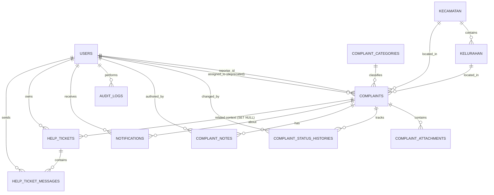

# Data Model & Database Specification
## Lapor Pak Wali MVP — MySQL

This file is the single source of truth for database entities and application-level data contracts. Migrations must implement this document. If an operational rule has not been approved, mark it `TODO: Define requirement` rather than silently turning an assumption into a permanent rule.

> **Scope note (Phase 3 O-1 / Phase 4E D-11…D-17).** This schema describes the **Lapor Pak Wali** MVP, which is now joined by the approved **WINDY public weather dashboard** (read-only public weather information on the landing page; SIPHP/JDIH remain unbuilt; **no GIS / wilayah boundary map**). The WINDY data model is **not defined here yet** and is **not part of the current migrations**; it is specified separately in `_superbie_audit/WINDY_DATA_MAPPING.md` (all table/column names there are **[USULAN]** pending design gate F3). WINDY tables must be added only after their release gates are met and this document is updated first, keeping exactly the **four existing roles**. **Phase 4E owner decisions:** 3-day forecast from free BMKG, WITA display, **no historical Sheets import** (no import-batch tables), legacy thresholds as initial values only.

## 1. Conventions

- Engine: MySQL with InnoDB and `utf8mb4`.
- Table names: plural `snake_case`; columns: `snake_case`.
- Primary key: `BIGINT UNSIGNED AUTO_INCREMENT` for internal entities.
- Public complaint reference: random opaque string, unique, not derived from ID or personal information.
- Timestamps: `created_at`, `updated_at`; soft deletion only where a real restore workflow is needed.
- Use foreign keys and transactions.
- Store tracking credential as a secure hash; never store raw secret.
- Password hash is managed by Laravel's password hashing.
- Status values in this document reflect the **official complaint lifecycle** finalized per Prompt 3B.

## 2. Entities

| Entity | Purpose | Type |
|---|---|---|
| users | Masyarakat, operator, admin, dan super admin identities | Core/auth |
| complaint_categories | Configurable complaint categories | Supporting |
| complaints | Main public complaint record | Core/business |
| complaint_attachments | Private file metadata | Supporting |
| complaint_status_histories | Immutable status transition history | Audit/business |
| complaint_notes | Internal notes or public responses | Business |
| notifications | In-app notification addressed to one user about one complaint milestone | Business |
| help_tickets | Help Desk support ticket (separate from complaints) | Business |
| help_ticket_messages | Append-only Help Desk conversation messages | Business |
| audit_logs | Sensitive staff/admin action log | Audit |

Masyarakat/pelapor wajib memiliki baris pada `users` dan login sebelum membuat laporan. Dashboard/riwayat hanya menampilkan laporan milik akun tersebut.

## 3. ERD



`assigned_to` is nullable and is a **DEPRECATED legacy compatibility column** (see §4.3 and PHASE 2R/6C). `changed_by`/`authored_by` may be nullable only if system-generated events are supported; decide consistently in implementation. Masyarakat/pelapor adalah `users` dengan role `masyarakat`. **PHASE 6C — Decision 2:** `assigned_to` is **DEPRECATED** — it is **never written by any active workflow and is never used as a routing mechanism**; the handling Operator is resolved automatically from `complaints.dinas_unit_id` (`DinasUnit::operator()`). No new code path may write, filter, or display it as active assignment. Historical values are preserved untouched (no bulk migration, no nulling, no reassignment, no column drop). Baris historis yang masih menunjuk akun peran lama (`petugas`) juga dipertahankan tanpa remap otomatis.

## 4. Table specifications

### 4.1 `users`
Purpose: authenticated masyarakat/pelapor and internal staff/admin accounts.

| Column | Type | Null | Default | Key/constraint | Notes |
|---|---|---:|---|---|---|
| id | BIGINT UNSIGNED | No | auto | PK | Internal ID |
| name | VARCHAR(120) | No | — | — | Display name |
| email | VARCHAR(255) | No | — | UNIQUE | Normalized email |
| nik | CHAR(16) | Yes | NULL | UNIQUE | NIK 16 digit; wajib bagi masyarakat; **immutable** setelah dibuat; nullable hanya untuk baris lama (Prompt 5B) |
| phone_number | VARCHAR(20) | Yes | NULL | UNIQUE | Nomor HP; format lokal/internasional, dinormalisasi ke `08…`; wajib bagi masyarakat (Prompt 5B) |
| address | TEXT | Yes | NULL | — | Alamat; free text tanpa batas bisnis; wajib bagi masyarakat (Prompt 5B) |
| password | VARCHAR(255) | No | — | — | Laravel password hash |
| role | VARCHAR(30) | No | `masyarakat` | CHECK/app validation | `masyarakat`, `operator`, `admin`, `super_admin` (peran historis `petugas` hanya boleh muncul pada baris lama, bukan nilai baru) |
| dinas_unit_id | BIGINT UNSIGNED | Yes | NULL | FK → dinas_units.id, ON DELETE SET NULL; **UNIQUE (`users_dinas_unit_id_unique`)** | Operator's Dinas/Unit membership (Prompt 15, BDR-1 = 1a: one Operator → exactly one unit; PHASE 1: one unit → at most one Operator). Only meaningful for `operator`; forced NULL for every other role — enforced at the **model layer** (`User::booted()` `saving` guard, Prompt 21) so no persistence path can bypass it. The UNIQUE index guarantees the 1:1 rule at the DB layer (MySQL treats NULLs as distinct, so non-operators / unit-less Operators never collide). Assigned/changed **only by Super Admin** via User Management (D-2, Prompt 21); an already-owned unit is rejected (Form Request + model guard) until the current Operator is released. An Operator with NULL here is DENIED all complaints (no global fallback). Deactivation does NOT clear it. A used/removed Dinas/Unit never deletes the account (SET NULL) |
| is_active | BOOLEAN | No | true | — | Inactive users cannot sign in |
| email_verified_at | TIMESTAMP | Yes | NULL | — | Use only if email verification is enabled |
| remember_token | VARCHAR(100) | Yes | NULL | — | Laravel remember-me |
| created_at | TIMESTAMP | Yes | NULL | — | Laravel timestamp |
| updated_at | TIMESTAMP | Yes | NULL | — | Laravel timestamp |

Use Laravel's standard `users` migration conventions where compatible. If role/permission package is later adopted, update this document first.

### 4.2 `complaint_categories`
Purpose: categories available for classifying complaints.

| Column | Type | Null | Default | Key/constraint | Notes |
|---|---|---:|---|---|---|
| id | BIGINT UNSIGNED | No | auto | PK | |
| name | VARCHAR(100) | No | — | — | Display name |
| slug | VARCHAR(120) | No | — | UNIQUE | Stable key |
| description | VARCHAR(500) | Yes | NULL | — | Optional |
| dinas_name | VARCHAR(150) | Yes | NULL | — | Legacy/convenience display label. **NOT a routing source of truth** (Prompt 6 §10). Authoritative Category ↔ Dinas/Unit routing uses the `category_dinas_unit` mapping below (Prompt 5B). **PHASE 6C — Decision 8:** RETAINED as a historical value (no column drop); it is not the routing source of truth. |
| is_active | BOOLEAN | No | true | INDEX with is_active where useful | Inactive category unavailable for new submissions |
| sort_order | SMALLINT UNSIGNED | No | 0 | — | Presentation ordering |
| created_at | TIMESTAMP | Yes | NULL | — | |
| updated_at | TIMESTAMP | Yes | NULL | — | |

Official category list: `TODO: Define requirement`. Seed only explicitly approved categories or clearly marked development fixtures.

**Category management (FINAL, Prompt 6):** Super Admin manages categories via `super-admin/kategori` (index/create/store/edit/update/**activate/deactivate**/destroy). Only Super Admin may manage master data (server-side `role:super_admin` + Form Request `authorize()`). Categories are **active/inactive**: an inactive category is rejected server-side for new complaints (never merely hidden in the UI). A category that has **ever been used by a complaint** MUST NOT be hard-deleted — the model layer blocks it and the `DELETE` endpoint returns a redirect + error; Super Admin must **deactivate** it. Deactivating a category **never** alters existing complaints (`category_id`, status, destination, timeline, audit all unchanged). `slug` is a derived, unique, server-generated key (not accepted from request).

### 4.2.1 `dinas_units`

Purpose: official Dinas/Unit entities. **Many-to-many** with categories (FINAL, Prompt 5B). **One-to-one** with the owning Operator (`users.dinas_unit_id`, PHASE 1 — at most one Operator per unit).

| Column | Type | Null | Default | Key/constraint | Notes |
|---|---|---:|---|---|---|
| id | BIGINT UNSIGNED | No | auto | PK | |
| name | VARCHAR(150) | No | — | — | Dinas/Unit name |
| code | VARCHAR(50) | Yes | NULL | UNIQUE | Optional stable code |
| description | VARCHAR(500) | Yes | NULL | — | Optional |
| is_active | BOOLEAN | No | true | INDEX | |
| sort_order | SMALLINT UNSIGNED | No | 0 | — | |
| created_at | TIMESTAMP | Yes | NULL | — | |
| updated_at | TIMESTAMP | Yes | NULL | — | |

### 4.2.2 `category_dinas_unit` (pivot)

Purpose: many-to-many mapping Category ↔ Dinas/Unit, managed by Super Admin (`super-admin/kategori/{category}/mapping`, `SyncCategoryMappingRequest`). This pivot is the **current master mapping** — it is **NOT** the complaint's historical destination (that is `complaints.dinas_unit_id`).

| Column | Type | Null | Key/constraint | Notes |
|---|---|---:|---|---|
| id | BIGINT UNSIGNED | No | PK | |
| category_id | BIGINT UNSIGNED | No | FK → complaint_categories.id, ON DELETE CASCADE | |
| dinas_unit_id | BIGINT UNSIGNED | No | FK → dinas_units.id, ON DELETE CASCADE | |
| created_at / updated_at | TIMESTAMP | Yes | — | |

UNIQUE(category_id, dinas_unit_id). Official Dinas/Unit list: `TODO: Define requirement` (not seeded).

### 4.2.3 `kecamatan`

Purpose: Kecamatan master data (FINAL location rule). Source of truth = **BPS**; the official dataset is **not provided yet**, so **no rows are seeded** (inventing wilayah names is forbidden). Managed by **Super Admin only**.

| Column | Type | Null | Default | Key/constraint | Notes |
|---|---|---:|---|---|---|
| id | BIGINT UNSIGNED | No | auto | PK | |
| name | VARCHAR(150) | No | — | — | Kecamatan name |
| code | VARCHAR(50) | Yes | NULL | UNIQUE | Optional stable code (e.g. BPS area code). Format is supplied with the official data — never invented |
| created_at | TIMESTAMP | Yes | NULL | — | |
| updated_at | TIMESTAMP | Yes | NULL | — | |

Deliberately **NO `is_active`** (FINAL: location master has no active/inactive lifecycle) and **NO GIS fields** (latitude/longitude/polygon/geometry/postal_code) — GIS is out of scope.

### 4.2.4 `kelurahan`

Purpose: Kelurahan master data (FINAL location rule). A Kelurahan belongs to exactly **one** Kecamatan. Source of truth = **BPS**; **not seeded**. Managed by **Super Admin only**.

| Column | Type | Null | Default | Key/constraint | Notes |
|---|---|---:|---|---|---|
| id | BIGINT UNSIGNED | No | auto | PK | |
| kecamatan_id | BIGINT UNSIGNED | No | — | FK → kecamatan.id, ON DELETE RESTRICT | Owning Kecamatan (mandatory) |
| name | VARCHAR(150) | No | — | — | Kelurahan name |
| code | VARCHAR(50) | Yes | NULL | UNIQUE | Optional stable code (e.g. BPS area code) |
| created_at | TIMESTAMP | Yes | NULL | — | |
| updated_at | TIMESTAMP | Yes | NULL | — | |

Deliberately **NO `is_active`** and **NO GIS fields**. FK is `ON DELETE RESTRICT`: a Kecamatan that still owns Kelurahan cannot be hard-deleted (the model layer blocks it first).

### 4.3 `complaints`
Purpose: main complaint data owned by an authenticated masyarakat/pelapor.

| Column | Type | Null | Default | Key/constraint | Notes |
|---|---|---:|---|---|---|
| id | BIGINT UNSIGNED | No | auto | PK | Internal ID |
| reference_code | VARCHAR(32) | No | — | UNIQUE | Random opaque public reference |
| tracking_secret_hash | VARCHAR(255) | Yes | NULL | — | **DEPRECATED (PHASE 6C — Decision 4).** Legacy hash of a random secret; there is **no public tracking endpoint** that ever verifies it, and it is **no longer written**. Retained for historical preservation only; never exposed in any response |
| category_id | BIGINT UNSIGNED | Yes | NULL | FK → complaint_categories.id | Nullable until category workflow is confirmed |
| dinas_unit_id | BIGINT UNSIGNED | Yes | NULL | FK → dinas_units.id, ON DELETE SET NULL | ACTUAL Dinas/Unit destination, decided by **Super Admin** during initial validation (PHASE 2R; not by the Operator); stored (not dynamic) for historical stability; **NOT derived from `category_dinas_unit`**. Null only when not yet routed. A Dinas/Unit used here cannot be hard-deleted (Prompt 5C.1) |
| assigned_to | BIGINT UNSIGNED | Yes | NULL | FK → users.id, ON DELETE SET NULL | **DEPRECATED legacy compatibility column (PHASE 6C — Decision 2).** Never written by any active workflow and never used as a routing mechanism; the handling Operator is resolved from `dinas_unit_id`. Historical values preserved untouched; no column drop |
| reporter_id | BIGINT UNSIGNED | No | — | FK → users.id, ON DELETE RESTRICT | Masyarakat/pelapor pemilik laporan |
| reporter_email | VARCHAR(255) | Yes | NULL | — | RETAINED snapshot (PHASE 6C — Decision 6): still written at creation and shown to Super Admin staff; hindari ekspos publik |
| reporter_phone | VARCHAR(30) | Yes | NULL | — | **DEPRECATED (PHASE 6C — Decision 5)** — always NULL (no phone snapshot is taken); **no longer written**; retained for historical preservation only |
| title | VARCHAR(180) | No | — | — | Short summary |
| description | TEXT | No | — | — | Complaint details |
| location_text | VARCHAR(255) | Yes | NULL | — | Human-readable/free-form additional location. **Retained** (not removed). Independent of the structured pair below |
| kecamatan_id | BIGINT UNSIGNED | Yes | NULL | FK → kecamatan.id, ON DELETE RESTRICT | Structured location — Kecamatan. **NULLABLE** so legacy complaints (pre-feature) remain valid; **REQUIRED for NEW complaints** (enforced in `StoreComplaintRequest`, all categories). A Kecamatan used here cannot be hard-deleted |
| kelurahan_id | BIGINT UNSIGNED | Yes | NULL | FK → kelurahan.id, ON DELETE RESTRICT | Structured location — Kelurahan. Must belong to the submitted `kecamatan_id` (server-side pair validation). **NULLABLE** for legacy complaints; **REQUIRED for NEW complaints**. A Kelurahan used here cannot be hard-deleted |
| latitude | DECIMAL(10,7) | Yes | NULL | — | OPTIONAL geographic latitude (Prompt 4/5). **NULLABLE** — a complaint is valid without coordinates. Range −90..90 (validated server-side). Must form a PAIR with `longitude` (partial pair rejected). No GIS/spatial type, no index |
| longitude | DECIMAL(10,7) | Yes | NULL | — | OPTIONAL geographic longitude (Prompt 4/5). **NULLABLE**. Range −180..180 (validated server-side). Must form a PAIR with `latitude` (partial pair rejected). No GIS/spatial type, no index |
| status | VARCHAR(40) | No | `submitted` | INDEX | Official status. See §6 for values and transition matrix |
| review_state | VARCHAR(40) | Yes | NULL | INDEX (review_state, submitted_at) | **PHASE 2 / PHASE 3** — Super Admin validation review state, SEPARATE from `status`. Values: `pending_initial_validation`, `returned_to_citizen`, `validated_for_operator` (PHASE 2) + `pending_completion_validation`, `completion_returned_to_operator` (PHASE 3). **NULL = legacy** complaint created before the validation gate existed (treated as already routed → operator-visible; no fabricated history). New complaints always receive an explicit value. Never a lifecycle status |
| review_return_reason | TEXT | Yes | NULL | — | **PHASE 2** — reporter-visible return note set when the Super Admin returns a complaint to the citizen (mandatory at that action). NOT an internal-only note; deleted with the complaint by retention |
| review_state_updated_at | TIMESTAMP | Yes | NULL | — | **PHASE 2** — when `review_state` last changed (queue ordering / "waktu menunggu validasi"). Set on create, return and resubmission |
| completion_submitted_at | TIMESTAMP | Yes | NULL | — | **PHASE 3** — when the Operator SUBMITTED the completion for Super Admin validation (set by `operator.complaint.submit-completion`). NULL before submission and cleared on approval / return. Server time only |
| completion_return_reason | TEXT | Yes | NULL | — | **PHASE 3** — Super Admin's reason for returning a completion to the Operator. **INTERNAL** (Operator/staff only — NEVER shown to the reporter). Deliberately SEPARATE from `review_return_reason` (the return-to-citizen message). Cleared when the Operator resubmits. Deleted with the complaint by retention |
| public_updated_at | TIMESTAMP | Yes | NULL | — | **DEPRECATED (PHASE 6C — Decision 7).** Legacy public-tracking timestamp; **no longer written** by any active workflow and **not read by any view** (no public tracking exists). Retained for historical preservation only |
| submitted_at | TIMESTAMP | No | current time | INDEX | Submission time |
| resolved_at | TIMESTAMP | Yes | NULL | — | Set only for approved resolved state |
| created_at | TIMESTAMP | Yes | NULL | — | |
| updated_at | TIMESTAMP | Yes | NULL | — | |

Recommended FK behavior:
- `category_id` → `complaint_categories.id`: `ON DELETE SET NULL` (defensive DB behavior only). **Application layer MUST prevent hard-delete of any Category that has ever been used by a complaint** (Prompt 6 §6) — Super Admin must **deactivate** it. Deleting a *used* Category is blocked at the model layer and via the `DELETE` endpoint; historical complaints always keep their stored `category_id`. Never cascade-delete complaints. Only **unused** Categories may be hard-deleted.
- `dinas_unit_id` → `dinas_units.id`: `ON DELETE SET NULL` (defensive DB behavior only). **Application layer MUST prevent hard-delete of any Dinas/Unit that has ever been used by a complaint** (Prompt 5C.1) — Super Admin must **deactivate** it. Deleting a *used* Dinas/Unit is blocked at the model layer and via the `DELETE` endpoint; historical complaints always keep their stored destination. Never cascade-delete complaints. Only **unused** Dinas/Unit may be hard-deleted.
- `assigned_to` → `users.id`: `ON DELETE SET NULL`.
- `kecamatan_id` → `kecamatan.id`: `ON DELETE RESTRICT` (defensive DB behavior). **Application layer MUST prevent hard-delete of any Kecamatan used by a complaint or still owning Kelurahan** — blocked at the model layer and via the `DELETE` endpoint. Complaints are **never** cascade-deleted and legacy `location_text` is never modified.
- `kelurahan_id` → `kelurahan.id`: `ON DELETE RESTRICT` (defensive DB behavior). **Application layer MUST prevent hard-delete of any Kelurahan used by a complaint** — blocked at the model layer and via the `DELETE` endpoint.
- Never expose `tracking_secret_hash` or personal contact fields in public responses.

### 4.4 `complaint_attachments`
Purpose: metadata for files held in private storage.

| Column | Type | Null | Default | Key/constraint | Notes |
|---|---|---:|---|---|---|
| id | BIGINT UNSIGNED | No | auto | PK | |
| complaint_id | BIGINT UNSIGNED | No | — | FK → complaints.id, ON DELETE RESTRICT | Preserve records until retention policy is defined |
| disk | VARCHAR(50) | No | `private` | — | Laravel disk name |
| path | VARCHAR(500) | No | — | — | Generated storage path; never user-controlled |
| original_name | VARCHAR(255) | No | — | — | Treat as untrusted display text |
| mime_type | VARCHAR(120) | No | — | — | Server-detected |
| size_bytes | BIGINT UNSIGNED | No | — | — | |
| checksum_sha256 | CHAR(64) | Yes | NULL | — | Optional integrity verification |
| created_at | TIMESTAMP | Yes | NULL | — | |

**FINAL (Prompt 5B):** attachments are optional; max **10 files** per complaint; max **20 MB** per file; formats **JPG/JPEG/PNG/PDF/MP4**; **no malware scanning** required for the MVP. Files are private with no public storage access. Source of truth: `config/business_rules.php`. Never store attachment binaries in MySQL for this MVP.

### 4.5 `complaint_status_histories`
Purpose: append-only record of status transitions.

| Column | Type | Null | Default | Key/constraint | Notes |
|---|---|---:|---|---|---|
| id | BIGINT UNSIGNED | No | auto | PK | |
| complaint_id | BIGINT UNSIGNED | No | — | FK → complaints.id, ON DELETE RESTRICT | |
| from_status | VARCHAR(40) | Yes | NULL | — | NULL for initial status |
| to_status | VARCHAR(40) | No | — | — | Validate allowed values |
| changed_by | BIGINT UNSIGNED | Yes | NULL | FK → users.id, ON DELETE SET NULL | Null for system event only |
| note | VARCHAR(1000) | Yes | NULL | — | Avoid sensitive details |
| created_at | TIMESTAMP | Yes | current time | INDEX with complaint_id | No updated_at; history is append-only |

### 4.6 `complaint_notes`
Purpose: store staff notes and responses separately by visibility.

| Column | Type | Null | Default | Key/constraint | Notes |
|---|---|---:|---|---|---|
| id | BIGINT UNSIGNED | No | auto | PK | |
| complaint_id | BIGINT UNSIGNED | No | — | FK → complaints.id, ON DELETE RESTRICT | |
| author_id | BIGINT UNSIGNED | Yes | NULL | FK → users.id, ON DELETE SET NULL | |
| visibility | VARCHAR(24) | No | `internal` | — | `internal`, `public_response` |
| body | TEXT | No | — | — | Plain text for MVP; escape on output |
| created_at | TIMESTAMP | Yes | current time | INDEX with complaint_id | Append-only in normal UI |

### 4.7 `audit_logs`
Purpose: trace important privileged actions without duplicating full complaint contents.

| Column | Type | Null | Default | Key/constraint | Notes |
|---|---|---:|---|---|---|
| id | BIGINT UNSIGNED | No | auto | PK | |
| actor_id | BIGINT UNSIGNED | Yes | NULL | FK → users.id, ON DELETE SET NULL | Null for system event |
| action | VARCHAR(100) | No | — | INDEX | Stable action key |
| subject_type | VARCHAR(100) | Yes | NULL | — | Allowlisted model/type |
| subject_id | BIGINT UNSIGNED | Yes | NULL | — | Polymorphic reference without polymorphic FK |
| metadata | JSON | Yes | NULL | — | Strict allowlist; never secrets or full PII |
| ip_address | VARCHAR(45) | Yes | NULL | — | Retention/privacy policy required |
| user_agent | VARCHAR(500) | Yes | NULL | — | Truncate; retention policy required |
| created_at | TIMESTAMP | Yes | current time | INDEX | Append-only in application |

### 4.8 `notifications`
Purpose: in-app (in-system) notification addressed to exactly one user about exactly one complaint milestone. Added by **PHASE N4**. This is the application's OWN notification table — it is **NOT** the Laravel polymorphic `notifications` shape and does **not** use Laravel's `Notifiable` database channel (no email, no queue, no broadcast, no realtime).

| Column | Type | Null | Default | Key/constraint | Notes |
|---|---|---:|---|---|---|
| id | BIGINT UNSIGNED | No | auto | PK | |
| recipient_user_id | BIGINT UNSIGNED | No | — | FK → users.id, ON DELETE RESTRICT | Exactly one recipient; owner-scoped queries use this column |
| complaint_id | BIGINT UNSIGNED | No | — | FK → complaints.id, ON DELETE RESTRICT | The complaint this milestone is about (follows retention) |
| type | VARCHAR(64) | No | — | part of UNIQUE idempotency key | Business milestone key (see §6 milestones) |
| title | VARCHAR(180) | No | — | — | Rendered, recipient-safe text (escaped on output) |
| body | TEXT | No | — | — | Generic text; **never** internal reason/note or PII |
| data | JSON | Yes | NULL | — | Minimal renderer hints only (`complaint_id`, `reference_code`, `milestone`, `status`); **no** PII, secrets, or hardcoded URLs |
| read_at | TIMESTAMP | Yes | NULL | INDEX with recipient_user_id | **NULL = unread**; set to server time when read |
| source_event_id | BIGINT UNSIGNED | No | — | part of UNIQUE idempotency key | Canonical `audit_logs.id` of the business action that produced this milestone (idempotency anchor) |
| created_at | TIMESTAMP | Yes | NULL | INDEX with recipient_user_id | Newest-first ordering |
| updated_at | TIMESTAMP | Yes | NULL | — | |

**Constraints / indexes:**
- `UNIQUE(recipient_user_id, complaint_id, type, source_event_id)` (`notifications_idempotency_unique`) — the **database-layer** idempotency guarantee: one business action × one recipient = exactly one logical notification. Retrying the same business action re-uses the same canonical audit row, so a duplicate insert is impossible.
- `INDEX(recipient_user_id, read_at)` (`notifications_recipient_read_idx`) — unread count / unread listing.
- `INDEX(recipient_user_id, created_at, id)` (`notifications_recipient_recent_idx`) — newest-first listing / bell dropdown.
- FK behaviour mirrors the other complaint children: **RESTRICT** on both parents. Users are deactivated (never hard-deleted); the 5-year retention purge deletes notification rows **before** the parent complaint.

**PHASE N4 — In-app notifications (FINAL):**
- **In-app only.** No email/Mailable/Mail facade, no queue/Job, no broadcasting/websocket/realtime, no Laravel `Notifiable` database channel. Notifications are created by an **explicit** `NotificationService` from the business action (never observers/events/listeners), so a single business action can never fan out into duplicate notifications.
- **Inside the same transaction.** Every notification is inserted **INSIDE** the caller's existing `DB::transaction`, immediately after the canonical `AuditLog::create(...)` whose id is passed as `source_event_id`. If the notification insert fails, the whole business action rolls back (no orphan notification, no half-applied state).
- **Recipients (frozen matrix).** Masyarakat gets **own-complaint** milestones; the Operator gets **own-Dinas** milestones, resolved **only** from `complaints.dinas_unit_id → DinasUnit::operator()` (never `assigned_to`); every **active** Super Admin gets the relevant milestones (single query); **Admin and historical `petugas` receive NOTHING**; the **actor is never notified** about their own action; an **inactive** recipient gets **no new** notification (existing ones are kept; a reactivated user can receive future ones). When a Dinas/Unit has **no** Operator, the Operator notification is skipped and logged — there is **never** a fallback (G8).
- **Milestone matrix:** M1 `complaint_submitted` (Super Admin); M2 `initial_validation_approved` (Operator + reporter); M3 `initial_validation_returned` (reporter); M4 `complaint_resubmitted` (Super Admin); M5 `completion_submitted` (Super Admin); M6 `completion_returned` (Operator); M7 `completion_validated` (reporter + Operator); M8 `status_in_progress` (reporter); M9 `status_waiting_for_information` (reporter); M10 `status_rejected` (reporter); M11 `status_closed` (reporter + Operator); M12 `rating_submitted` (Operator + Super Admin). A **standalone** public response (M13) creates **no** notification; a public response published **as part of** M7 is covered **once** by M7.
- **LC-2 — dormant milestones (M9, M11):** under the active lifecycle (`submitted → in_progress → {resolved | rejected}`) the transitions to `waiting_for_information` and `closed` no longer exist, so **M9** (`status_waiting_for_information`) and **M11** (`status_closed`) are **dormant** for the new workflow. Their constants, recipient mapping, and code branches are deliberately **retained** (not removed) for historical compatibility; no new complaint can trigger them. Historical notifications already delivered under M9/M11 remain and are still readable. Milestones M1–M8, M10, M12 remain active.
- **Read/unread:** `read_at IS NULL` = unread. Opening a notification marks it read; single mark-read; mark-all; owner-scoped unread count; listing is newest-first and paginated **20/page**; the bell badge is **hidden at 0** and shows **9+** for large counts.
- **Owner-scoped (IDOR closed):** every read/mark/delete query starts from `auth()->user()->appNotifications()` with a **scalar** route id (never an implicitly-bound model), so a user can only ever read/mark/delete their **own** notification. A user may **delete** their own notification (the complaint itself is never touched).
- **Action URL resolved at render time** from `(type, recipient role, complaint_id)` — **never stored** in `data`. Invalid/stale targets fall back to a safe listing page (never an error, never a cross-scope target).
- **Privacy:** `data` is minimal and contains **no** PII, internal reason/note, secrets, or hardcoded URLs. Internal reasons (M3/M6) and internal narratives are **never** placed in a notification.
- **Retention:** notifications are CHILD data of the complaint; `ComplaintRetentionService::purge()` deletes notification rows **before** the parent complaint (FK RESTRICT). The 5-year-from-`submitted_at` policy is **unchanged**.
- **No caching** of notification queries; the Super Admin fan-out is a single query (no N+1).

### 4.9 `help_tickets`
Purpose: a **Help Desk / Pusat Bantuan** support ticket. Added by **PROMPT TAHAP 2**. A ticket is **separate from a complaint**: it never mutates a complaint's status/category/routing/notes; `related_complaint_id` is only a context reference.

| Column | Type | Null | Default | Key/constraint | Notes |
|---|---|---|---:|---|---|---|
| id | BIGINT UNSIGNED | No | auto | PK | |
| reference_code | VARCHAR(32) | No | — | UNIQUE | Server-generated `HD-YYYYMMDD-XXXX` |
| user_id | BIGINT UNSIGNED | No | — | FK → users.id, ON DELETE RESTRICT | Ticket owner (citizen) |
| subject | VARCHAR(180) | No | — | — | Rendered escaped |
| category | VARCHAR(40) | No | — | — | Allowlist `App\Enums\HelpDeskCategory` |
| description | TEXT | No | — | — | Opening description; escaped on output |
| related_complaint_id | BIGINT UNSIGNED | Yes | NULL | FK → complaints.id, ON DELETE SET NULL | OPTIONAL context reference; NULLed if the complaint is purged |
| status | VARCHAR(30) | No | `open` | — | Allowlist `App\Enums\HelpTicketStatus` |
| resolved_at | TIMESTAMP | Yes | NULL | — | Set when `resolved`; cleared on reopen |
| created_at | TIMESTAMP | Yes | NULL | INDEX with user_id | |
| updated_at | TIMESTAMP | Yes | NULL | INDEX with status | Bumped on every message (last activity) |

### 4.10 `help_ticket_messages`
Purpose: the append-only Help Desk conversation. Added by **PROMPT TAHAP 2**. There is deliberately **no** update/delete path.

| Column | Type | Null | Default | Key/constraint | Notes |
|---|---|---|---:|---|---|---|
| id | BIGINT UNSIGNED | No | auto | PK | |
| help_ticket_id | BIGINT UNSIGNED | No | — | FK → help_tickets.id, ON DELETE RESTRICT | |
| user_id | BIGINT UNSIGNED | No | — | FK → users.id, ON DELETE RESTRICT | Sender — ALWAYS the authenticated user (never request input) |
| body | TEXT | No | — | — | Escaped on output |
| created_at | TIMESTAMP | Yes | NULL | INDEX with help_ticket_id | Chronological ordering |
| updated_at | TIMESTAMP | Yes | NULL | — | |

**PROMPT TAHAP 2 — Help Desk (FINAL for this step):**
- **Additive migration only.** `2025_01_10_100020_create_help_desk_tables` creates both tables; no existing table/column/row is modified, no backfill, reversible via `dropIfExists` (messages first).
- **FK behaviour:** `help_tickets.user_id` and `help_ticket_messages.user_id` use **RESTRICT** (accounts are deactivated, never hard-deleted). `help_ticket_messages.help_ticket_id` uses **RESTRICT** (messages are children of a ticket; there is no ticket deletion path in this step). `help_tickets.related_complaint_id` uses **ON DELETE SET NULL** so the frozen 5-year complaint purge deletes a complaint WITHOUT deleting or blocking the ticket — the ticket survives with a NULL reference.
- **Reference code:** server-generated `HD-YYYYMMDD-XXXX` (random 4-char suffix, uniqueness-checked), never derived from the id or personal data.
- **Status enum** `App\Enums\HelpTicketStatus`: `open`, `in_progress`, `waiting_for_user`, `resolved`, `closed`. **Transition matrix:** `open → in_progress|waiting_for_user|resolved|closed`; `in_progress → waiting_for_user|resolved|closed`; `waiting_for_user → in_progress|resolved|closed`; `resolved → in_progress|closed`; `closed → (terminal)`. Super Admin performs every transition via an explicit action; a citizen performs only the `resolved → in_progress` reopen edge (message required).
- **Category enum** `App\Enums\HelpDeskCategory`: `account_login`, `app_usage`, `complaint_submission`, `complaint_tracking`, `technical_other` — the explicit validation allowlist.
- **Conversation rules:** a plain reply is allowed only while `open`/`in_progress`/`waiting_for_user`. `resolved` rejects plain replies (only a validated reopen), and `closed` is terminal — a closed ticket never silently receives messages. A reply on `waiting_for_user` returns the ticket to `in_progress`; the first official reply on `open` moves it to `in_progress`.
- **Authorization:** citizen routes are `auth` + `role:masyarakat` with an explicit `user_id`-scoped lookup (foreign id → 404, IDOR closed); the Super Admin panel is `auth` + `role:super_admin` (Admin/Operator denied server-side). Sender/owner/status are NEVER read from the request.
- **Validation:** `subject` max 180; `description`/`body` max 5000; empty/whitespace-only bodies rejected and trimmed; category validated against the enum allowlist. `related_complaint_id` must belong to the ticket creator.
- **Audit:** actions `help_ticket.created`, `help_ticket.message_sent`, `help_ticket.staff_replied`, `help_ticket.reopened`, `help_ticket.status_updated` (`subject_type = 'help_ticket'`). Metadata holds action/actor/reference/status/length only — **never** the message/description contents.
- **Rate limit:** the write endpoints carry the named limiter `help-desk-write` (config: `business_rules.help_desk_write_rate_limit` = 20 / 10 minutes, keyed on the authenticated user id).
- **NOT included (open):** moderation, ticket attachments, ticket notifications, SLA/escalation, automatic ticket close/delete, and a ticket retention policy (see §13). Help Desk tickets are **NOT** part of the 5-year complaint purge.

### 4.11 `complaint_ratings.admin_response` (STAGE 3 — official reply)

Purpose: a **single official Super Admin reply** to the citizen's written review. Added by **STAGE 3** as a NEW nullable column on the EXISTING `complaint_ratings` table (no new table, no new model). It rides on the same immutable 1:1 rating row, so it inherits the rating's lifecycle and is purged with it.

| Column | Type | Null | Default | Key/constraint | Notes |
|---|---|---|---|---|---|
| admin_response | TEXT | Yes | NULL | — | Official Super Admin reply; NULL = not yet answered |

- **Migration:** `2025_01_11_100021_add_admin_response_to_complaint_ratings_table` — ADDITIVE and reversible (`down()` drops only this column). No backfill; historical ratings keep `admin_response = NULL`.
- **Why a column, not a table:** the reply is a 1:1, at-most-one artifact; `complaint_ratings` already models "one row per complaint" (UNIQUE `complaint_id`) and already carries `review_text`. A single nullable column is the minimal, consistent design.
- **Create-once + immutable:** enforced with a row-locked conditional `UPDATE ... WHERE admin_response IS NULL` inside a transaction. There is NO update/delete path. A concurrent second request affects 0 rows and is rejected.
- **Never mutates anything else:** `rating`, `review_text`, the complaint status, the KPI, and the rating analytics are untouched.
- **Audit:** `complaint.review_responded` (`subject_type = 'complaint'`) with metadata `reference_code`, `complaint_id`, `rating_id`, `has_response: true` — NEVER the review/reply text.
- **Retention:** since the reply lives on the rating row, the existing 5-year complaint purge deletes it together with `complaint_ratings` (no new retention mechanism, no change to the purge).
- **Route:** `POST /super-admin/balasan-ulasan/{complaint}` (`super-admin.review-response.store`), intentionally OUTSIDE the read-only `/super-admin/laporan` prefix.

## 5. Index strategy

| Table | Index | Purpose |
|---|---|---|
| users | UNIQUE(email) | Login identity |
| complaint_categories | UNIQUE(slug) | Stable category key |
| complaints | UNIQUE(reference_code) | Public tracking lookup |
| complaints | (status, submitted_at) | Staff list/filter |
| complaints | (category_id, submitted_at) | Category list |
| complaints | (reporter_id, submitted_at) | Citizen history/dashboard |
| complaints | (assigned_to, status, submitted_at) | Legacy index retained for historical rows (`assigned_to` is a DEPRECATED column; see §4.3). Active workload/KPI queries no longer use it |
| complaint_status_histories | (complaint_id, created_at) | Timeline |
| complaint_notes | (complaint_id, created_at) | Complaint detail |
| audit_logs | (actor_id, created_at) | Audit review |
| audit_logs | (action, created_at) | Action review |
| notifications | UNIQUE(recipient_user_id, complaint_id, type, source_event_id) | Idempotency (one business action × one recipient) |
| notifications | (recipient_user_id, read_at) | Unread count / unread listing |
| notifications | (recipient_user_id, created_at, id) | Newest-first listing / bell dropdown |
| help_tickets | UNIQUE(reference_code) | Ticket reference lookup |
| help_tickets | (user_id, created_at) | Citizen ticket list |
| help_tickets | (status, updated_at) | Super Admin panel list/filter |
| help_tickets | (category) | Super Admin category filter |
| help_ticket_messages | (help_ticket_id, created_at) | Conversation timeline |

Validate indexes against actual queries and `EXPLAIN`; do not add duplicate indexes if a unique constraint already creates one.

## 6. Status and enums

**LC-2 lifecycle (FINAL).** Seven status values are retained in the enum and in the database for historical hydration and audit compatibility, but only **four** belong to the active lifecycle. The remaining three are **legacy** (history only). No migration and no mass update converts legacy rows.

| Code | Public Label | Category | Notes |
|---|---|---|---|
| `submitted` | Diajukan | **Active** | Initial status for every new complaint |
| `in_progress` | Sedang Diproses | **Active** | Complaint is actively being worked on (set by the Super Admin initial validation) |
| `resolved` | Selesai | **Final business outcome** | Successful outcome; public response required |
| `rejected` | Ditolak | **Final business outcome** | Rejection outcome; rejection reason + public response required |
| `under_review` | Sedang Ditinjau | **Legacy** | Historical only — not reachable by any active transition |
| `waiting_for_information` | Menunggu Informasi | **Legacy** | Historical only — not reachable by any active transition |
| `closed` | Ditutup | **Legacy** | Historical only — manual close retired; not reachable by any active transition |

Classification helpers (`App\Enums\ComplaintStatus`): `activeCases()` = `[submitted, in_progress]`; `finalOutcomeCases()` = `[resolved, rejected]`; `legacyCases()` = `[under_review, waiting_for_information, closed]`. `isActiveLifecycle()`, `isFinalOutcome()` (≡ `isTerminal()`), and `isLegacy()` classify a case.

**Active lifecycle (two main paths):**

```
submitted ──► in_progress ──► resolved   (success)
                       └────► rejected   (rejection)
```

**Official Transition Matrix (3 allowed transitions — the active lifecycle):**

| From | Allowed To |
|---|---|
| `submitted` | `in_progress` |
| `in_progress` | `resolved`, `rejected` |
| `resolved` | *(final business outcome — no outgoing transition)* |
| `rejected` | *(final business outcome — no outgoing transition)* |
| `under_review` | *(legacy — no outgoing transition)* |
| `waiting_for_information` | *(legacy — no outgoing transition)* |
| `closed` | *(legacy — no outgoing transition)* |

`allowedTransitions()` returns exactly the three edges above and `[]` for every other case; `hasOutgoingTransitions()` is derived from it (true only for `submitted` and `in_progress`).

**Explicitly forbidden transitions (representative):**
- `submitted → rejected` (FORBIDDEN — pre-validation rejection is a return-to-citizen, not a status change)
- Any transition into or out of a legacy status (`under_review`, `waiting_for_information`, `closed`)
- Any transition out of a final business outcome (`resolved`, `rejected`) — the former manual close edge `resolved → closed` is **retired**
- No reopen of any kind

**Authority to change status:**
- Operator: YES for `submitted → in_progress` and `in_progress → rejected`, scoped to own Dinas/Unit — but **NO** for `→ resolved`: an Operator **cannot** set a complaint to `resolved` directly (the completion gate requires Super Admin approval; see the PHASE 3 completion sections). The block is enforced server-side.
- Super Admin: YES (global scope), including the `in_progress → resolved` completion-approval path.
- Admin: NO (monitoring only)
- Masyarakat: NO
- System / automatic: NO (no auto-close, no scheduler, no grace period)

**Additional rules:**
- `rejected` requires: rejection reason (non-empty) + public response (non-empty)
- `resolved` requires: public response (non-empty)
- No reopen workflow. `resolved` and `rejected` are the two final business outcomes; there is no transition out of either.
- Rating may only be given while the complaint is `resolved` (owner-only, 1–5, once).
- **Legacy rows** (`under_review`, `waiting_for_information`, `closed`) are **status-locked** (no transition may enter or leave them) but are **NOT** globally mutation-locked: non-status actions (internal note, public response, geographic-location update) still follow the ordinary permission rules. They remain readable to their permitted audiences.
- All status mutations are atomic: status + history + audit in one transaction.

**PHASE 3 — Bagian 3 — Closing / finalization (`resolved → closed`) — SUPERSEDED by LC-2 (manual close retired):**
- **LC-2 status (FINAL):** the manual close edge `resolved → closed` is **retired**. `resolved` and `rejected` are final business outcomes and `closed` is now a **legacy** status retained for history only. The behaviour below documents the earlier PHASE 3 Bagian 3 decision, which is **no longer reachable** through the active lifecycle.
- **Who (D-3.1, historical):** Operator (own Dinas/Unit) and Super Admin (global). Admin and Masyarakat cannot. There is NO system/auto close.
- **When (D-3.2, historical):** MANUAL only, through the existing `operator.complaint.update-status` endpoint. No auto-close, no scheduler, no grace period, no timer. There is deliberately NO `closed_at` column.
- **Rating (D-3.3):** OPTIONAL. A NULL rating never blocks finalization. Rating stays exactly as frozen in Bagian 2 (owner-only, 1–5, once, only while `resolved`).
- **Post-close semantics (D-3.4, still true for historical `closed` rows):** `closed` is status-locked — it is NOT a global mutation lock. Staff may still add an internal note, add a public response, and update the geographic location; category / Dinas-Unit / assigned-Operator / completion submission / reopen remain blocked exactly as elsewhere. Citizen keeps read access (detail, timeline, public response, attachment, existing rating) but cannot mutate and cannot submit a new rating.
- **Concurrency (D-3.5, historical):** the transition ran inside a transaction with `lockForUpdate()` and a stale-state re-check against the locked row, so a double close could never produce a duplicate status history or a duplicate audit event.
- **Audit:** the existing action `complaint.status_updated` is kept (no new `complaint.closed` action). **Retention** stays 5 years from `complaints.submitted_at`. Existing `closed` rows are retained untouched (no migration, no conversion).

- `users.role`: `masyarakat`, `operator`, `admin`, `super_admin`. Peran historis `petugas` tidak lagi dibuat untuk akun baru; baris lama yang masih bernilai `petugas` tidak diubah otomatis.
- `complaint_notes.visibility`: `internal`, `public_response`.
- `notifications.type` (**PHASE N4** — in-app notification milestone, NOT a complaint status): `complaint_submitted`, `initial_validation_approved`, `initial_validation_returned`, `complaint_resubmitted`, `completion_submitted`, `completion_returned`, `completion_validated`, `status_in_progress`, `status_waiting_for_information`, `status_rejected`, `status_closed`, `rating_submitted`. Recipient audiences are resolved from the milestone (see §4.8). A standalone public response is **not** a milestone (no notification).
- `complaints.review_state` (**PHASE 2 / PHASE 3** — Super Admin validation state, SEPARATE from `status`): `pending_initial_validation`, `returned_to_citizen`, `validated_for_operator` (PHASE 2) plus `pending_completion_validation`, `completion_returned_to_operator` (PHASE 3). **NULL** = legacy complaint (created before the validation gate; treated as already routed for backward compatibility). This is **not** a lifecycle status — the 7 statuses above are unchanged and no status value was added.
- `help_tickets.status` (**PROMPT TAHAP 2** — Help Desk lifecycle, SEPARATE from complaint status): `open`, `in_progress`, `waiting_for_user`, `resolved`, `closed`. See §4.9 for the explicit transition matrix.
- `help_tickets.category` (**PROMPT TAHAP 2**): `account_login`, `app_usage`, `complaint_submission`, `complaint_tracking`, `technical_other` (allowlist `App\Enums\HelpDeskCategory`).

**PHASE 2 — Super Admin initial validation (FINAL):**
- Every **new** citizen complaint is created with `status = submitted` AND `review_state = pending_initial_validation`. There is **no** citizen → operator path: an Operator cannot see a complaint until the Super Admin validates it.
- Approval (`submitted → in_progress`, the single first active transition) sets `review_state = validated_for_operator`, writes the **final** category, routes to a Dinas/Unit that is (a) mapped to the final category via `category_dinas_unit`, (b) active, and (c) has an Operator — then the Operator is resolved **automatically** from `complaint.dinas_unit_id` (`DinasUnit::operator()`). `complaints.assigned_to` is **never** used as a routing mechanism. Approval emits notification **M2** only (no duplicate M8).
- Return-to-citizen sets `review_state = returned_to_citizen` and stores a **mandatory** `review_return_reason`. It is **NOT** a rejection — `status` stays `submitted`. The reporter may correct their own returned complaint (title, description, category, location, attachments) and resubmit the **same** complaint (never a new row, never a double count, daily limit unaffected); resubmission returns it to `pending_initial_validation`.
- Operator visibility (Prompt 15 hybrid rule) additionally requires `review_state = validated_for_operator` **OR** `review_state IS NULL` (legacy). Pending/returned complaints are excluded server-side. (**PHASE 3** extends the admitted set with `pending_completion_validation` and `completion_returned_to_operator`; see the PHASE 3 section below.)
- Audit events: `complaint.initial_validation_approved`, `complaint.initial_validation_returned`, `complaint.category_corrected`, `complaint.dinas_assigned`, `complaint.citizen_resubmitted`. All approval mutations are atomic (single transaction).

**PHASE 2R — Operator immutability of routing metadata (FINAL):**
- An Operator **cannot** change a complaint's category (`category_id`), Dinas/Unit destination (`dinas_unit_id`), or Operator assignment (`assigned_to`). These three fields are decided **only** by the Super Admin initial-validation surface and are resolved automatically from `complaints.dinas_unit_id`.
- Enforcement is **server-side and structural**: the former operator endpoints `PATCH /operator/laporan/{complaint}/kategori`, `.../tujuan`, and `.../tugaskan` were **removed entirely** (no route → 404 for every actor), so there is no code path through which an Operator (or any actor) could mutate those columns via the operator surface. The Operator detail page renders them as **read-only** information (no form, no `<select>`); UI removal is a convenience, never the guarantee.
- Geographic location (**Kecamatan/Kelurahan/coordinates**, `PATCH /operator/laporan/{complaint}/lokasi`) is a **separate concern** and remains Operator-editable — it never touches `dinas_unit_id`.
- `complaints.assigned_to` is **DEPRECATED (PHASE 6C — Decision 2)**: it is never written by any active workflow, never used as a routing mechanism or metric/filter source, and historical values are preserved untouched (no bulk migration, no nulling, no reassignment, no column drop). The legacy `assignee()` relation and `scopeAssignedTo()` / `User::assignedComplaints()` are retained **only** for historical inspection and MUST NOT be used for active assignment.
- The Super Admin initial-validation surface (`super-admin/validasi/...`) keeps full category correction + Dinas routing; `category_dinas_unit` mapping management and Dinas → Operator relationship management are unchanged.

**PHASE 3 — Completion Validation Gate (FOUNDATION, additive):**
- After an Operator finishes a complaint, the completion must pass a Super Admin validation before the complaint becomes final `resolved`. The gate is expressed through `review_state` (NOT a new `ComplaintStatus`): `validated_for_operator → pending_completion_validation` (Operator submits) and `pending_completion_validation → validated_for_operator` (Super Admin approves) or `→ completion_returned_to_operator` (Super Admin returns to the Operator, who may resubmit).
- Submitting or returning a completion does **NOT** change `status` (it stays `in_progress`). Only **approval** performs `in_progress → resolved` (an existing, allowed transition). No new status and no new transition were added.
- New columns: `completion_submitted_at` (TIMESTAMP NULL — when the Operator submitted for validation; reset on approval/return) and `completion_return_reason` (TEXT NULL — **internal** Super Admin → Operator reason; NEVER shown to the reporter, deliberately separate from `review_return_reason`). Both are nullable with no backfill; legacy rows are untouched; retention deletes them with the complaint.
- Operator visibility (single source of truth `scopeVisibleToOperator`) now also admits `pending_completion_validation` and `completion_returned_to_operator` (Dinas/Unit match still required) so an Operator keeps seeing its own in-flight work; `pending_initial_validation` and `returned_to_citizen` remain excluded.
- **Scope of this foundation:** enum + migration + model casts/helpers/scopes + retention compatibility + domain tests. Routes, controllers, UI, submit/approve/return actions, notifications and rating are **not** part of this step.

**PHASE 3 — Operator completion submission (Bagian 1B-2, FINAL for this step):**
- An Operator finishes a complaint and **SUBMITS the completion** for Super Admin validation via `PATCH /operator/laporan/{complaint}/ajukan-penyelesaian` (route `operator.complaint.submit-completion`). This is **NOT** a status change: `status` STAYS `in_progress`, `resolved_at` is NOT set, no `resolved` status history is written, and **no citizen-visible public response is created**.
- On submit: `review_state` → `pending_completion_validation`; `completion_submitted_at` is stamped with server time; `completion_return_reason` is cleared (a resubmission supersedes a prior return). `review_return_reason` (the PHASE 2 return-to-citizen message) is left untouched.
- **AUTHORITY CHANGE (matrix unchanged):** an Operator may **NO LONGER** set a complaint to `resolved` directly — the legacy status endpoint rejects `→ resolved` for non-Super-Admin actors server-side (not UI-only). The Operator path is now: `in_progress → Ajukan Penyelesaian → pending_completion_validation` (status stays `in_progress`). Super Admin retains the `→ resolved` authority (its approval surface is a later part).
- The OPTIONAL completion narrative is stored as an **INTERNAL** `complaint_notes` row (citizen-invisible) and is **not** published here; publication happens at Super Admin approval (a later part). Uses the existing notes mechanism — no speculative schema.
- Audit event: `complaint.completion_submitted` (metadata: reference_code, dinas_unit_id, operator_id, old/new review_state, status, completion_submitted_at, completion_note_id). All changes are atomic (single transaction with `lockForUpdate`); a double submission is rejected with no duplicate audit.
- **PHASE N6A / F-1 (FINAL):** while the complaint is at `review_state = pending_completion_validation`, the **Operator** may **NOT** use "Perbarui Status" (`operator.complaint.update-status`) at all — not to `waiting_for_information`, not to `rejected`, not to `closed`, and no other transition. The guard is enforced server-side **before any mutation** (and re-asserted against the locked row inside the transaction); a blocked request writes **no** status change, `resolved_at`, status history, success audit, public response, or notification, and **never** rewrites `review_state`. `review_state = completion_returned_to_operator` **restores** the normal status options. **Super Admin is unaffected** (G7). No status and no transition were added.

**PHASE 3 — Super Admin completion validation (Bagian 1C, FINAL for this step):**
- A SEPARATE Super Admin surface (controller `SuperAdminCompletionValidationController`, routes under `/super-admin/validasi-penyelesaian/...`) reviews submitted completions. It is **deliberately separate** from the PHASE 2 initial-validation surface (different queue, eligibility and side effects).
- Queue (`super-admin.completion-validation.index`) lists **ONLY** complaints with `review_state = pending_completion_validation` **AND** `status = in_progress` (PHASE N6C / N6B-1, FINAL — Option A), ordered `completion_submitted_at ASC, id ASC` (oldest submitted first). `completion_returned_to_operator`, `validated_for_operator`, `pending_initial_validation`, `returned_to_citizen` and legacy NULL rows are **excluded**. The `status = in_progress` condition also excludes any stale `pending_completion_validation` row whose status was changed by a frozen G7 direct resolve (see the G7 note below).
- **PHASE N6C / N6B-1 — G7 interaction (FINAL):** a Super Admin direct resolve through the shared status endpoint (`operator.complaint.update-status`, frozen G7) performs `in_progress → resolved` and deliberately does **NOT** rewrite `review_state`. Such a row therefore keeps `resolved + pending_completion_validation`. It simply **disappears from the Completion Validation Queue** because it no longer satisfies `status = in_progress`. The queue filter is a **read-only rule** — it never mutates `review_state`. `Approve` **and** `Return` on that row are still independently rejected server-side (status ≠ `in_progress`; PHASE N6E / N6D-1), and its completion-validation detail page is rendered read-only.
- **APPROVE** (`POST .../setujui`, `super-admin.completion-validation.approve`) performs the single **existing** transition `in_progress → resolved` (validated via `ComplaintStatus::canTransitionTo()` — no raw status write, no new transition/enum). On approve: `review_state → validated_for_operator`; `resolved_at = now()`; `completion_submitted_at` is **KEPT** (historical); `completion_return_reason` is cleared; a `complaint_status_histories` row `in_progress → resolved` is written; the previously-**INTERNAL** completion narrative is **published** as a citizen-facing `public_response` note (the internal note is **not** deleted — it stays as internal audit trail); audit event `complaint.completion_validated`. `category_id`, `dinas_unit_id` and `assigned_to` are never touched.
- **Public-response safety:** `resolved` REQUIRES a citizen-facing response. The **only** allowed source is the Operator's own internal completion narrative, located via the `completion_note_id` recorded in the `complaint.completion_submitted` audit (no new schema). When that narrative is missing/blank/deleted, approval is **REJECTED** with an error — the public response is **never fabricated**.
- **RETURN** (`POST .../kembalikan`, `super-admin.completion-validation.return`) sends the completion back to the Operator. The reason is **mandatory** (min 10 chars, trimmed server-side) and stored in `completion_return_reason` — an **INTERNAL** Operator/staff message, **NEVER** shown to the reporter, deliberately separate from `review_return_reason`. On return: `status` STAYS `in_progress`; `resolved_at` stays NULL; `completion_submitted_at` is cleared (the Operator must resubmit); `review_state → completion_returned_to_operator`; **no** resolved history and **no** public response are written; audit event `complaint.completion_returned`. Category/Dinas/assigned Operator are never touched.
- **RETURN eligibility (PHASE N6E / N6D-1, FIXED):** like APPROVE, RETURN is only actionable from `status = in_progress` **AND** `review_state = pending_completion_validation`. The check runs before any mutation and is re-asserted against the **locked** row inside the transaction. A stale `pending_completion_validation` row whose status is not `in_progress` (e.g. the frozen G7 direct-resolve row `resolved + pending_completion_validation`, or a `rejected`/`closed` row) is **REJECTED** with a validation error: **no** mutation, **no** `complaint.completion_returned` audit, **no** `completion_return_reason`, **no** `completion_submitted_at` clearing, **no** `review_state` change, **no** M6 notification. The completion-validation **detail** page stays reachable for such a row but is rendered **read-only** (no Approve/Return action; a "Tidak Lagi Dapat Divalidasi" notice), so the M5 deep-link never 404s. Queue filtering remains **not** the authorization boundary — the server-side guards are.
- **Authorization:** only a Super Admin may reach the queue/detail/approve/return (route middleware `role:super_admin`, server-side). Admin is monitoring-only (no approve/return/status/review-state change); Operator/Masyarakat get 403; a guest is redirected to login. Every action re-asserts `review_state = pending_completion_validation` INSIDE a `lockForUpdate` transaction, so a double approve/return, approve-after-return and return-after-approve can never both succeed (single transaction; status/review_state/resolved_at/history/public response/audit all commit or roll back together).
- **No new migration** (reuses the existing `completion_submitted_at` / `completion_return_reason` columns) and **no new retention mechanism** (both columns live on the `complaints` row, so the 5-year purge deletes them with the complaint). No rating, notification, public tracking, reopening or SLA was added.

**PHASE 3 — Citizen satisfaction rating (Bagian 2, FINAL for this step):**
- A new child table `complaint_ratings` stores ONE satisfaction rating (1–5 stars) per complaint. Columns: `id`, `complaint_id` (FK → `complaints.id`, `ON DELETE RESTRICT`), `user_id` (FK → `users.id`, `ON DELETE RESTRICT` — the rater = the complaint owner), `rating` (`UNSIGNED TINYINT`), `review_text` (`TEXT NULL` — PHASE 3 Bagian 2 review, see below), `admin_response` (`TEXT NULL` — STAGE 3 official reply, see §4.11), `created_at`/`updated_at`. `complaint_id` carries a **UNIQUE** index — one complaint = at most ONE rating (the database, not application validation, is the primary duplicate/race defense).
- **Eligibility (frozen business decision):** a rating may ONLY be given while the complaint status is **`resolved`**. `closed` (and every other status) is **NOT** eligible — after a complaint becomes `closed` the reporter cannot submit a new rating. Eligibility is derived from `ComplaintStatus` ONLY (via `Complaint::canBeRated()`); `review_state` is never consulted (`validated_for_operator` alone does NOT imply eligibility).
- **Ownership (IDOR closed):** only the complaint OWNER may rate — validated server-side against `complaints.reporter_id === auth()->id()`. Another citizen, Operator, Admin, or Super Admin is rejected (403); a guest is redirected to login. The request body is NEVER trusted as a source of ownership (no `complaint_id`/`user_id` accepted from input; the complaint comes from route model binding).
- **Route:** `POST /laporan/{complaint}/rating` (`citizen.rating.store`) inside the existing `auth` + `role:masyarakat` group. There is deliberately **no** GET / PATCH / PUT / DELETE rating route and **no** API route — the rating is create-once and **immutable**.
- **Invariants:** submitting a rating NEVER mutates `complaint.status`, `complaint.review_state`, `complaint.resolved_at`, `completion_submitted_at` or `completion_return_reason`, and creates NO `complaint_notes` / public response / status history. Only the `complaint_ratings` row is written.
- **Validation:** `rating` required, integer, min 1, max 5 (rejects 0, 6, negatives, decimals, arbitrary strings, and a missing value) — enforced server-side via `StoreComplaintRatingRequest`.
- **Concurrency:** the `complaint_id` UNIQUE index makes a double submission / race impossible; the controller catches the duplicate-key violation and returns a consistent error, never overwriting the first rating and never writing a second audit.
- **Audit event:** `complaint.rating_submitted` (metadata: `reference_code`, `complaint_id`, `reporter_id`, `rating`, `complaint_status`) — written ONLY after the rating is persisted (a failed submission writes no successful audit).
- **Retention:** `complaint_ratings` is CHILD data deleted by the existing 5-year purge (`ComplaintRetentionService::purge()` deletes rating rows before the parent complaint). No new retention mechanism; period/reference/command/scheduler unchanged.
- **UI:** the citizen complaint detail shows the "Rating Kepuasan" section (5 accessible star choices, labels "1 bintang" … "5 bintang", a keyboard/screen-reader-friendly `radiogroup`) ONLY while `status = resolved` and no rating exists. After submission the form is replaced by the read-only "Rating Anda: ★★★★☆" display. `closed` and every other status show no form.
- **Scope:** citizen-only. No staff submission, no rating analytics/dashboard/average/ranking/export, no notification, no public tracking, no reopening/SLA, and **no** `ComplaintStatus`/`ComplaintReviewState` change (7 enum values retained; active lifecycle = 4 statuses / 3 transitions — see §6; 5 review states).

**PHASE 3 — Bagian 2 — Written review ("ulasan tertulis") on the rating (ADDITIVE):**
- **Column:** `complaint_ratings.review_text` (`TEXT NULL`). NULL = a rating with no written review. Migration `2025_01_09_100019_add_review_text_to_complaint_ratings_table` (additive; no backfill; legacy ratings keep `review_text = NULL`; reversible via `dropColumn`).
- **Optional + immutable:** the review is OPTIONAL (nullable). It rides on the SAME create-once, immutable `complaint_ratings` row — there is NO separate table, NO separate route, and NO update/delete path. A blank/whitespace-only value is stored as `NULL` (`ComplaintRating::hasReview()` treats blank as absent).
- **Inherited rules (no new authorization surface):** because it lives on the rating row, the review automatically inherits owner-only (`complaints.reporter_id === auth()->id()`), `status = resolved` eligibility (`Complaint::canBeRated()`), one-per-complaint, and the `complaint_id` UNIQUE duplicate defense. `complaint_id`/`user_id` are NEVER read from the request body.
- **Validation:** `review_text` nullable, string, max 5000 (via `StoreComplaintRatingRequest`). Stored as-is; rendered ONLY through Blade escaping (no HTML is trusted).
- **Audit:** `complaint.rating_submitted` gains a `has_review` **boolean** in its metadata — the review text is deliberately **NOT** copied into audit metadata.
- **Visibility:** reporter (own `citizen.complaint.show`, read-only) + Operator (`operator.complaint.show`) + Super Admin (`super-admin.complaints.show`), all **read-only**. Admin has NO per-complaint detail route, so the review is not exposed to Admin. Internal notes remain invisible to the reporter.
- **Analytics unchanged (D-4.8):** the review is NOT part of Rating Analytics — the aggregate-only rule (no individual record / drill-down / detail page / export) still holds; no individual-review endpoint exists.
- **Moderation:** **UNDETERMINED** — `prd.md` §4 keeps the moderation policy as `TODO: Define requirement`. NO moderation logic is implemented; the text is stored as-is. (The Help Desk feature F-017 is a **separate** module; the STAGE 3 official reply is documented in §4.11 and is **not** a citizen-to-citizen conversation.)
- **Retention:** the review is deleted with the rating row by the existing 5-year complaint purge (it is a column on `complaint_ratings`, which the purge already deletes before the parent complaint). No new retention mechanism.

**PHASE 4 — Bagian 2 — Rating Analytics (D-4.1..D-4.15, FROZEN):**
- **Viewers (D-4.1 / AF):** Admin = GLOBAL; Super Admin = GLOBAL; Operator = **own Dinas/Unit ONLY**; Masyarakat = **denied** (403 via `role:` middleware); Guest = login redirect. Authorization is **server-side** (route middleware + service scope), never merely a hidden menu/disabled `<select>`/JavaScript.
- **Operator scope (D-4.9 = B):** the scope is FORCED from `users.dinas_unit_id` (the single source of truth — **never** `complaints.assigned_to`). A client-supplied `dinas_unit_id` is **ignored**; an Operator with no unit is DENIED (no global fallback). Operators never receive a per-Dinas comparison list or a Dinas filter that could reveal another unit.
- **Metrics (D-4.2):** total rating; average rating; distribution 1–5; `resolved_without_rating`; per Dinas/Unit (count/avg/satisfaction); per category (count/avg/satisfaction); monthly trend; satisfaction rate. **No** extra metric (no ranking, leaderboard, employee/Dinas score, SLA, sentiment, AI, weighted average).
- **Satisfaction (D-4.3 / D-4.4):** `rating 1–3 = tidak puas`, `rating 4–5 = puas`; `satisfaction rate = COUNT(rating IN 4,5) / COUNT(all ratings) × 100%`. Unrated complaints are **NEVER** in the denominator.
- **Resolved without rating (D-4.5, OPTION A, FINAL):** a **current-state coverage** aggregate — complaints whose **CURRENT** `status = resolved` AND which have **no** `complaint_ratings` row (`NOT EXISTS`). It is deliberately **NOT** filtered by the rating period: it does **not** use `complaint_ratings.created_at` (there is no rating row) and does **not** use `complaints.resolved_at`. Changing the rating period **never** changes this value. It DOES keep the DIMENSION filters that are semantically meaningful for a complaint (Dinas/Unit, Kategori, Kecamatan, Kelurahan) + the Operator scope. It is an honest separate coverage/backlog count — **NOT** a negative rating, **NOT** a dissatisfaction signal, and **NEVER** part of the satisfaction denominator. `rejected` / `closed` are **not** counted (there is no `closed_without_rating`).
- **Time basis (D-4.10 / E):** every RATING metric filters on **`complaint_ratings.created_at`** — never `complaints.submitted_at` / `resolved_at`. Period presets: **6 bulan** / **12 bulan** (calendar months, consistent with the existing dashboard trend — not arbitrary 180/365 days), **tahun berjalan** (1 Jan → today), **custom** (validated `start <= end`, both bounds required — never an unbounded query).
- **Filters (D-4.7 = C):** Periode, Dinas/Unit, Kategori, Kecamatan, Kelurahan — all genuinely affect the aggregates (no dummy filter). Kelurahan is **bounded by the selected Kecamatan** server-side; invalid filter values are dropped, never trusted.
- **Privacy (D-4.8 = A):** AGGREGATE ONLY. No reporter name / NIK / phone / address / individual rating record / drill-down / detail page / individual-data export. No individual-rating endpoint exists.
- **Resolved vs closed (D-4.11 = A):** a rating validly given while `resolved` is STILL counted after the complaint later becomes `closed` (the rating base query has NO complaint-status filter).
- **Retention (D-4.12 = A):** live data only — no snapshot/archive/denormalized aggregate. Ratings follow the existing 5-year complaint purge.
- **Empty state (D-4.13 = A):** reuses `x-dashboard.empty-state`; a period/filter with no rating shows the empty state — **never** a fabricated `0%` satisfaction.
- **No export (D-4.14 = A):** no CSV / Excel / PDF / export button / export endpoint.
- **Cache (D-4.15 = A):** TTL 60s (same as every dashboard block). Rating submission does not touch the `complaints` row, so a dedicated `ComplaintRatingObserver` bumps the `dashboard:rating:version` counter the moment a rating is created, invalidating every rating-analytics cache in one write. Complaint/master-data changes also bump it (via `clearGlobalDashboardCaches()`), because the aggregates join `complaints` + master data. A dedicated key namespace `dashboard:rating:{scope}:{filter-hash}:{version}` is required because the analytics is FILTERED (period + 4 filters) and cannot share the single filterless `dashboard:admin` key — documented reason per D-4.15.
- **Host / routes (O / AJ):** rendered as a section on the EXISTING dashboards (`admin.dashboard`, `super-admin.dashboard`, `operator.dashboard`) — **no new route** (route inventory stays 85), **no API route**, **no new page**.
- **Query (S):** aggregate SQL only (`COUNT` / `AVG` / `SUM(CASE …)` / `GROUP BY`), batch name lookups, **no N+1**; filters are applied in the database.
- **No migration (AE):** the existing `complaint_ratings` schema is sufficient; no index/migration was added.

Prefer VARCHAR plus PHP backed enums/validation for portability and controlled application transitions. Add database CHECK constraints only if supported by the target MySQL version and aligned with migrations.

## 7. Relationships and deletion rules

- Category has many complaints; **do not hard-delete a category referenced by complaints** — the model layer blocks it and the `DELETE` endpoint rejects it (Prompt 6 §6). Deactivate instead; historical complaints keep their `category_id`.
- User may be assigned many complaints; deleting/deactivating a user must not erase complaints. Prefer deactivation; FK can set assignment null.
- Dinas/Unit has **at most one** Operator via `users.dinas_unit_id` (PHASE 1 — the relationship is **one-to-one**, enforced by the UNIQUE index `users_dinas_unit_id_unique`, the User Management Form Request `unique` rule, and the model-layer `saving` guard; the Super Admin must release the current Operator before assigning another). Removing a master Dinas/Unit sets that column to NULL (never cascade-delete the account). The account simply loses scope until reassigned (Prompt 15). **Assignment lifecycle (FINAL, D-2 / Prompt 21):** an Operator's `dinas_unit_id` is assigned/changed **only by Super Admin** through User Management; a non-`operator` role always persists NULL (model-layer guard); deactivation does not clear the assignment.
- **Operator complaint visibility (FINAL, Prompt 15, BDR-1 = 1a, BDR-2 = 2c hybrid):** an Operator sees a Complaint iff `users.dinas_unit_id IS NOT NULL` AND (`complaints.dinas_unit_id = users.dinas_unit_id` OR (`complaints.dinas_unit_id IS NULL` AND the complaint's category is mapped to that unit via `category_dinas_unit`)). An Operator with no unit sees nothing (denied, no global fallback). Super Admin is GLOBAL and unscoped.
- Complaint has many attachments, status histories, and notes. **PHASE 3 — Bagian 2:** Complaint has **one** satisfaction rating (`complaint_ratings`, `complaint_id` UNIQUE); User (reporter) has many `complaint_ratings`. **STAGE 3:** the official Super Admin reply is a **column** on that same rating row (`admin_response`) — it is **not** a separate table and **not** a relationship (at most one reply per rating, resolved server-side from the complaint). **PHASE N4:** Complaint has many `notifications` (one per milestone × recipient); a User (recipient) has many `notifications` (`recipient_user_id`). A notification belongs to exactly one complaint and one recipient.
- **PROMPT TAHAP 2 — Help Desk:** a User (citizen) owns many `help_tickets` (`user_id`); a HelpTicket has many `help_ticket_messages` (chronological); a User authors many `help_ticket_messages` (`user_id`). A HelpTicket may reference ONE complaint (`related_complaint_id`) as **context only** — this link NEVER mutates the complaint. `help_tickets.user_id` / `help_ticket_messages.user_id` are `ON DELETE RESTRICT`; `help_ticket_messages.help_ticket_id` is `ON DELETE RESTRICT`; `help_tickets.related_complaint_id` is `ON DELETE SET NULL` (the ticket survives a complaint purge).
- **Kecamatan 1 ── N Kelurahan** (a Kelurahan belongs to exactly one Kecamatan). **Kecamatan 1 ── N Complaint** and **Kelurahan 1 ── N Complaint** (structured location). A Kecamatan/Kelurahan referenced by a complaint, or a Kecamatan that still owns Kelurahan, **cannot be hard-deleted** (model-layer guard + `DELETE` endpoint rejection + `ON DELETE RESTRICT`). Only unused master rows may be hard-deleted. Location master has **no `is_active`** (FINAL).
- Complaint deletion is not available in normal MVP UI. **Retention (FINAL, Prompt 5B.1):** a complaint is permanently deleted **5 years after `complaints.submitted_at`** by the backend command `complaints:purge-expired` (scheduler-driven). Deletion removes `complaints` plus child rows `complaint_status_histories`, `complaint_notes`, `complaint_attachments` (and their physical private files), `complaint_ratings` (PHASE 3 — Bagian 2; **including the STAGE 3 `admin_response` column it carries**), `notifications` (PHASE N4), and complaint-related `audit_logs` (`subject_type='complaint'`, matching `subject_id`). Users and master data (`complaint_categories`, `dinas_units`, `category_dinas_unit`, `kecamatan`, `kelurahan`) are **never** removed by retention. `submitted_at IS NULL` is never treated as expired (and the column is `NOT NULL` in practice). **PROMPT TAHAP 2:** `help_tickets` are **NOT** child data of a complaint and are **NOT** purged by this mechanism; only the `related_complaint_id` FK is set NULL when the referenced complaint is purged. **STAGE 3:** the official reply needs **no** retention mechanism of its own — it is a column on `complaint_ratings` and is deleted with it (see §4.11).
- Audit records are not cascaded away with the entity they refer to — **except** complaint-related audit logs, which the FINAL retention rule explicitly deletes together with their complaint (Prompt 5B.1). Unrelated audit logs are always preserved.

## 8. Validation contract

| Field | Rule | Notes |
|---|---|---|
| title | required string, max 180 | Trim whitespace; reject empty-after-trim |
| description | required string | Maximum length to be configured; do not accept unbounded payload |
| reporter_id | required authenticated user id for masyarakat/pelapor | Must match logged-in account |
| reporter_name | optional snapshot string, max 120 | Source is authenticated profile |
| reporter_email | optional valid email, max 255 | RETAINED snapshot (PHASE 6C — Decision 6); still written at creation from the authenticated profile. Normalize |
| reporter_phone | DEPRECATED (PHASE 6C — Decision 5) | No longer written (always NULL). Retained historical column; not collected |
| location_text | nullable string, max 255 | Free-form additional location; retained. Independent of the optional coordinates below |
| kecamatan_id | required (new complaints), integer, exists:kecamatan,id | FINAL: required for every new complaint, all categories. Legacy rows may be NULL |
| kelurahan_id | required (new complaints), integer, `Rule::exists('kelurahan','id')->where('kecamatan_id', kecamatan_id)` | Server-side pair check: the Kelurahan MUST belong to the submitted Kecamatan. `exists:kelurahan,id` alone is NOT sufficient. Frontend is never trusted. Same rule applies to the Operator location update |
| latitude | nullable numeric, between −90 and 90 | OPTIONAL (Prompt 4/5). Must form a PAIR with `longitude`; a partial pair is rejected server-side. Absent = NULL. Frontend GPS/map is never trusted |
| longitude | nullable numeric, between −180 and 180 | OPTIONAL (Prompt 4/5). Must form a PAIR with `latitude`; a partial pair is rejected server-side. Absent = NULL |
| reference_code | generated server-side | Never accept from public form |
| status | enum allowlist + transition rules | Never trust arbitrary client status |
| visibility | `internal` or `public_response` | Only authorized staff can create |
| file | approved MIME/extension, size/count limits | Values TODO; validate server-side |

## 9. Public tracking — NOT IMPLEMENTED

Public tracking is **not implemented** (frozen decision, Prompt 5B). There is **no** public tracking endpoint, controller, view, API, or data contract. Guests **cannot** view complaint data; a citizen must be **logged in** and can only see **their own** complaint (scoped to `reporter_id`).

Consequently, do not define, document, or return any "public projection" of a complaint. Any legacy illustrative shape of a public tracking payload is intentionally **removed** and must not be implemented. Never expose reporter contact details, `tracking_secret_hash`, internal notes, private file paths, staff email, audit data, or full model serialization in any response.

## 10. Citizen account and submission limit

- Masyarakat/pelapor must be authenticated before complaint creation.
- Complaint ownership is determined by `reporter_id`.
- Dashboard and history queries must be scoped to the authenticated `reporter_id`.
- A daily complaint limit applies per masyarakat/pelapor account: **FINAL (Prompt 5B) = 5 complaints / calendar day** (application timezone `Asia/Makassar`). It may be overridden via `app_settings.daily_report_limit`; the frozen default lives in `config/business_rules.php`.
- The limit must be enforced server-side and surfaced with a human-readable message.
- **Complaint submission rate limit (FINAL, Prompt 17, security/abuse protection — NOT a business rule):** 5 submissions / 10 minutes / authenticated user → **HTTP 429** when exceeded. Enforced by the named Laravel rate limiter `complaint-submission` applied via `throttle:` middleware on the submission route only; scope key = authenticated user id (never the client IP); a submission with any number of attachments counts as **one** submission. This is **separate** from, and never replaces, the daily business limit. Source of truth: `config/business_rules.php` (`complaint_submission_rate_limit`, `complaint_submission_rate_window_minutes`).

## 11. Transaction requirements

- Complaint submission + attachment metadata + initial status history must either all commit or all roll back.
- Status update + history + audit record must be atomic.
- If file storage succeeds but DB transaction fails, remove orphaned file(s) using compensating cleanup.
- Never perform a status update without writing its history record.

## 12. Seed data and migrations

- Seed roles only if represented in a separate role table; this schema uses a `users.role` field initially.
- Create one development-only admin account through environment-controlled seeding or a documented command. Never commit a production password.
- Category seed values require approval; if using fixtures, mark them clearly as demo data.
- **Location master (FINAL):** `kecamatan`/`kelurahan` are sourced from **BPS**. The official dataset is **NOT provided yet**, so the migration creates the **structure only** — **no Kecamatan/Kelurahan rows are seeded**, and wilayah names must never be invented. Once the official dataset is supplied, Super Admin manages the data via the dashboard.
- Migrations must be reversible where practical, ordered by FK dependencies, and tested on a clean database.
- **Geographic dashboard (Prompt 5/5):** the Admin "Peta Wilayah Aduan" card adds **no schema change and no migration**. Administrative counts are `GROUP BY complaints.kecamatan_id / complaints.kelurahan_id`; map points are read ONLY from rows where `latitude` **and** `longitude` are both non-NULL (valid pair). `location_text` is never parsed as coordinates. No GIS/spatial column, index, polygon, or boundary table is introduced.
- Production migrations run from version-controlled files after backup and review.

## 13. TODOs before production

- ~~Confirm required identity fields for masyarakat/pelapor account.~~ **DONE (Prompt 5B):** name, NIK (16 digit, unique, immutable), phone number (unique), address — all required.
- Confirm official categories + official Dinas/Unit list (currently `TODO: Define requirement`; seeds are clearly-marked development samples). Category ↔ Dinas/Unit mapping model is FINAL (many-to-many via `category_dinas_unit`).
- Confirm official status lifecycle and allowed transitions. **DONE — finalized per Prompt 3B.**
- ~~Confirm tracking verification and data visible publicly.~~ **DONE (Prompt 5B): public tracking NOT implemented; guest cannot view complaint data.**
- ~~Confirm file types, max size/count, retention, malware scanning.~~ **DONE (Prompt 5B / 5B.1): optional; max 10 files; max 20 MB/file; JPG/JPEG/PNG/PDF/MP4; no malware scanning; retention 5 years from `submitted_at` → permanent deletion.**
- Confirm privacy/retention policy for PII, IP addresses, user agents, audit metadata. **Privacy + retention FINAL (Prompt 5B/5B.1); audit-metadata retention nuance still open.**
- ~~Confirm whether notifications are required and which provider is approved.~~ **DONE (Prompt 5B): notifications NOT required for the MVP.**
- Confirm whether permissions need finer granularity beyond the 4 fixed roles (`masyarakat`, `operator`, `admin`, `super_admin`). **Granular permission manager NOT implemented / out of scope.**
- ~~Confirm how historical rows that still reference the legacy `petugas` role should be treated (retain, reassign, or archive).~~ **DONE (PHASE 6B Decision 1 / PHASE 6C): RETAINED as historical — no automatic remap, no reassignment, no deletion. No new Petugas actor/route is introduced.**
- ~~Confirm the lifecycle/retirement of legacy columns: `assigned_to`, `tracking_secret_hash`, `reporter_phone`, `reporter_email`, `public_updated_at`, `complaint_categories.dinas_name`.~~ **DONE (PHASE 6B/6C): `assigned_to`, `tracking_secret_hash`, `reporter_phone`, `public_updated_at` = DEPRECATED (no longer written, retained historical, no column drop); `reporter_email`, `complaint_categories.dinas_name` = RETAINED (historical snapshot).**
- ~~Confirm the semantics of the "belum ditugaskan" (`assigned_to IS NULL`) KPI after PHASE 2R.~~ **DONE (PHASE 6B Decision 3 / PHASE 6C): REDEFINED to "Belum Ditentukan Dinas/Unit" (`dinas_unit_id IS NULL`, active scope). The legacy `assigned_to IS NULL` metric is removed.**
- ~~Confirm the Operator assignment filter (mine/unassigned) semantics.~~ **DONE (PHASE 6B Decision 9 / PHASE 6C): REMOVED — an Operator is scoped by `dinas_unit_id`, so the assignment filter was meaningless.**
- Confirm whether staff password reset by Super Admin is a business requirement (currently NOT implemented).
- **WINDY weather data model (Phase 3 O-1/O-16 / Phase 4E D-11…D-17 — NOT yet in `schema.md`):** the approved WINDY feature needs its own tables (observations / historical aggregates / forecasts / alerts / source metadata) and a config-storage decision (`app_settings` vs a dedicated table). All are **[USULAN]** in `_superbie_audit/WINDY_DATA_MAPPING.md` and must be validated at design gate F3 and written into this document **before** any WINDY migration. **No import-batch tables** — **no historical Google Sheets import (D-15)**. **No GIS/wilayah boundary tables**; exactly **four roles**; WINDY is read-only public + Super-Admin-managed config/sync; **3-day forecast (D-11)**; **WITA display, timestamp storage convention still open (D-12/O-15)**.
- **PROMPT TAHAP 2 — Help Desk open items:** (a) retention/deletion policy for `help_tickets` (currently **none** — tickets are not purged); (b) content moderation for tickets/messages (currently **none**); (c) ticket notifications (currently **none** — the existing `notifications` table is complaint-anchored with a NOT NULL `complaint_id`, so reuse would change scope/schema); (d) SLA/escalation (currently **none**); (e) ticket attachments (currently **none**).
- **STAGE 3 — official review reply open items:** (a) notification for the reply (currently **none** — deliberately out of scope; the existing `notifications` table is complaint-anchored with a NOT NULL `complaint_id`); (b) threaded follow-up conversation (currently **none** — exactly one create-once reply, no thread); (c) moderation of reviews/replies (still `TODO: Define requirement`, `prd.md` §4); (d) dedicated retention for the reply (currently **none needed** — it is a column on `complaint_ratings` and is purged with the complaint).
